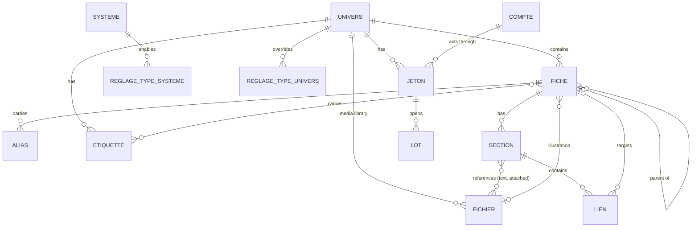
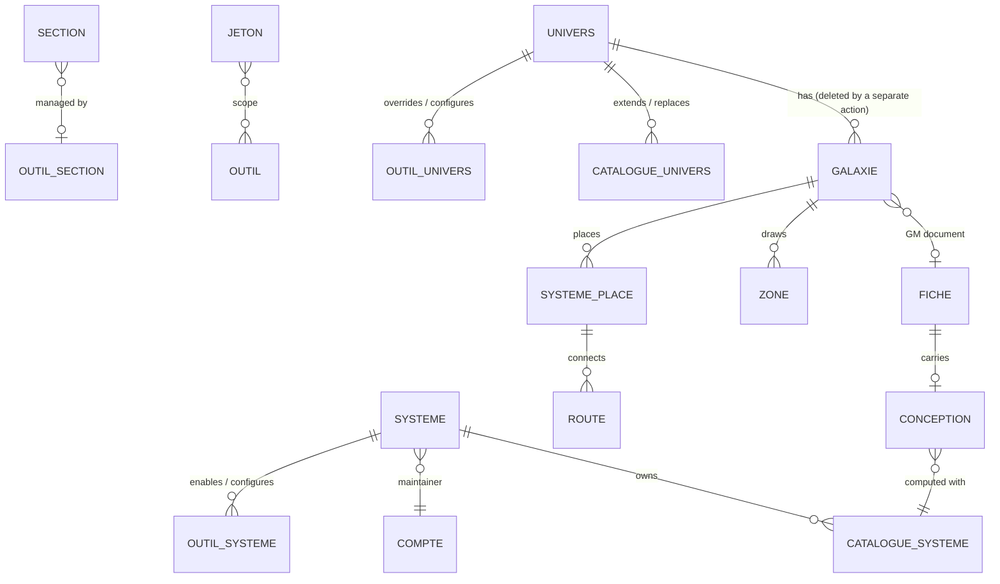

# Kanevas — data

> Product documentation (see `docs/parcours.md`, `docs/ecrans.md`). All product entities,
> their relationships and who reads or writes what. **A slice adds attributes; an extra
> entity is a scoping decision**, made before the slice (this is how maps, proposals and
> attachments came about), never along the way.

A single SQLite file on the volume (`/data/kanevas.db`, AD-5); foreign keys enabled, WAL,
a single write connection. Attachment bytes live on disk on the same volume
(`/data/attachments/`), never in the database (AD-7). Every read and write goes through the
backend service functions, called in the same way by routes and agent tools
(AD-2).

## Entities

| Entity | Holds | Relationships | Who reads | Who writes |
|---|---|---|---|---|
| **account** | Authelia identifier (`username`, unique), creation date; no role | — | the account itself; members of a shared universe (its identifier); a GM entering an exact identifier to add it learns only whether it exists; the instance admin | created at first sign-in (B-1) |
| **universe** | name, description, creation date | → game system (optional) | its members; its name: the instance admin | creation: any account (B-2); update: GM |
| **member** | (universe, account, GM \| Player role) | universe, account | universe members; the instance admin | universe GM; instance admin (this table only, AD-9); at least one GM per universe (B-5) |
| **game system** | name | ← universes; → templates | any universe GM (name only); content: members of an attached universe | creation: any GM; reference content: GM of an attached universe |
| **template** | type (rule, creature, item), name, content | game system | members of an attached universe | GM of an attached universe (B-14) |
| **sheet** | type (the product list, AD-102: character, location, faction, item, event, quest, session report, and since `kanevas-import` creature, race, ship, lore, story, rule, note), free-form **subtype** (B-52), title, creation date (original date if provided by the import, B-50), update date, payload versioned by type (AD-6) — character: PC \| NPC; session report: its campaign; optional **illustration** (at most one image, AD-93); *(kanevas-import)* optional **parent** (a sheet in the same universe, AD-99), **aliases**, **labels**, optional **origin key** | universe; → sections; → parent; ← children | anyone who reads at least one of its sections; otherwise it does not exist (B-9); its illustration, aliases, labels: anyone who sees the sheet; its origin key: the GM | creation: GM; a session report: any member (B-19); illustration, title, type, subtype, parent, aliases, labels, deletion: GM (B-38 to B-40, B-52) |
| **section** | title, order, content (Markdown since `kanevas-import`, AD-95, with its **GM blocks**, AD-98), update date; player read and write permissions; author (an account) with their read and write permissions; *(kanevas-import)* origin key, last import version | sheet; → relations, attachments, links | the GM; a player according to the toggles (AD-19), **without its GM blocks** | content: anyone with write permission, **a GM only if it contains a GM block**; structure and audience: GM |
| **relation** | type (free text), directed | carrying section → target sheet | anyone who reads the section **and** the target sheet (otherwise the target is not named) | GM |
| **file** *(kanevas-import, media library, AD-111)* | name, type (detected by signature; image if PNG, JPEG, GIF, WebP, document otherwise), size, disk filename (UUID), fingerprint, **visibility** (`joueurs` by default \| `mj`), added by, added on, origin key | universe; ← references (sections, illustrations) | the GM: all; a player: those marked `joueurs`, **and those they added** (third read rule, not a level: `ajoute_par`); **in a sheet**: if the container **and** the file are readable (double guard) | GM: everything; anyone who writes a section: add one from the sheet, together with its reference in one action (visibility based on where it is added, AD-111); the import |
| **file reference** *(kanevas-import)* | a file attached to a section, or cited in its text (and then either in a GM block or outside it); the illustration is a reference carried by the sheet | section → file; sheet → file (illustration) | same as the file, under the double guard | derived from the text at each write; attached or removed by anyone who writes the section; illustration: GM |
| **attachment** | *since `kanevas-import` (AD-111): a file reference attached to a section; « secrète » is the file visibility; below, the previous model, carried over by the migration* — original name, MIME type, size, disk filename (UUID), secret | section | anyone who reads the section, and the GM only if secret | anyone who writes the section; « secrète »: GM |
| **campaign** | name, status (in preparation, active, finished) | universe; → scenarios, tasks, reports | any member (name, status) | GM |
| **scenario** | title, content | campaign | GM | GM |
| **preparation task** | category (monsters, NPCs, maps, sequences, other), label, done | campaign | GM | GM |
| **map** | title, form (illustrated \| graph, fixed at creation), visible to players, background: an image uploaded to the map itself, stored on disk like an attachment (AD-40) | universe; → elements | GM; players if visible | GM |
| **map element** | position in % (illustrated map) or none (graph) | map, sheet | same as the element's sheet | GM |
| **link** *(kanevas-import)* | display text, target (a sheet, or a pending origin key, or none: broken), inside a GM block or outside it | carrying section → target sheet | same as a relation (AD-64): the section, outside GM blocks for a non-GM, **and** the target; otherwise text only | derived from the content at each section write (AD-97); nobody writes it separately |
| **alias** *(kanevas-import)* | another name for the sheet | sheet | anyone who sees the sheet | GM; the import |
| **label** *(kanevas-import)* | name, unique in the universe | universe; ↔ sheets | its sheets that an account sees; a label with no visible sheet does not exist for that account | GM; the import (created on first use) |
| **type setting** *(kanevas-import)* | a type, enabled or disabled — at system level; forced enabled or disabled — at universe level; absence means « suit » (inherit, AD-102) | game system or universe | members of an attached universe (system); universe members (universe) | GM of an attached universe (system, B-42); universe GM (universe) |
| **API token** *(kanevas-import)* | name, fingerprint (never the value), creation date, expiry date, revocation date, last use | universe, account of the GM who created it (the actor) | universe GMs (without the value) | creation: GM; revocation: any universe GM (B-45, B-46) |
| **import batch** *(kanevas-import)* | opening date, closing date, state, counters (created, updated, unchanged, refused, warnings), report of refusals and warnings | universe, token | universe GMs | the server, for a script presenting a token (B-49) |
| **proposal** | proposed content, original content fingerprint (the section's `version`, AD-59), creation date, application date | universe, requesting account, section, source report | its requester only | created by the GM's agent; applied once by its requester, if the section has not changed (B-21) |

**Search indexes**: two full-text indexes (FTS5), one on sheet titles, the other on section titles and content, kept
up to date by the database (triggers); no answer comes out without going through the
permissions filter again (AD-8, AD-21).

**No table** for: sessions (signed cookie), assistant conversations (the thread
lives in the browser, AD-28), graph layout (computed in the browser, AD-42),
its links (derived from relations, AD-41).

## Assistant (`kanevas-assistant-membre`)

No migration, no table, no attribute: the assistant reads and writes through existing service
functions (AD-2, AD-74), and the conversation thread is not stored anywhere (AD-28,
AD-75). The scoped `propositions` table is introduced by `kanevas-monde` (below).

## Update proposals (`kanevas-monde`)

One table, `propositions` (migration `0008-propositions.sql`, AD-51):

| Column | Type | Constraint |
|---|---|---|
| `id` | integer | key |
| `univers_id` | → `univers` | non-null; used to refuse a proposal read under another universe |
| `demandeur_id` | → `comptes` | non-null; the only account that reads, applies or abandons it (AD-79) |
| `section_id` | → `sections` | non-null; cascade deletion with the section |
| `cr_id` | → `fiches` | non-null; the `compte_rendu` sheet from which the proposal starts; cascade as a precaution (a report is deleted as a sheet, AD-119; the proposal then goes with it) |
| `contenu_propose` | text | non-null, non-empty, at most 100,000 characters (the section limit, AD-106; migration 0009) |
| `version_origine` | integer | non-null; the `version` the section had when the assistant read it (AD-59, AD-80) |
| `creee_le` | date | non-null |
| `appliquee_le` | date | null while pending |

Invariants enforced by the database or service function: **only one pending proposal per
(requester, section)** (partial unique index on `appliquee_le IS NULL`; the new one replaces
the old one in the same transaction); an applied proposal cannot be applied again or
abandoned; abandoning deletes the row; it is read only by its requester, still a GM of
the universe. No additional attribute on `sections`: AD-59's `version` suffices. On read: « périmée » (stale)
is not stored; it means current `version` ≠ `version_origine` **while the proposal has not been applied**, computed on each read; an applied proposal is always « appliquée » (applied; applying increases `version`).

## Migration 0001 (`kanevas-premiere-fiche`)

Five tables: `comptes`, `univers`, `membres`, `fiches`, `sections`. No search (FTS5 comes
with `kanevas-relier-chercher`, which takes the next number, AD-51).

| Table | Columns (excluding keys) | Constraints |
|---|---|---|
| `comptes` | `id`, `username` (Authelia identifier, `preferred_username`), `cree_le` | unique `username`; never a role or group (groups live in the session) |
| `univers` | `id`, `nom`, `description`, `cree_le` | non-empty `nom`, 1 to 80 characters |
| `membres` | `univers_id`, `compte_id`, `role` (`mj` \| `joueur`) | primary key (`univers_id`, `compte_id`); foreign keys; at least one `mj` per universe enforced by the service (B-5), not the database |
| `fiches` | `id`, `univers_id`, `type` (the seven: `personnage`, `lieu`, `faction`, `objet`, `evenement`, `quete`, `compte_rendu`; *since `kanevas-import`, the product list, without a `CHECK`: AD-102 and “`kanevas-import` scope” below*), `titre`, `charge` (versioned JSON, AD-6 and AD-17: `{"v":1}`; character `{"v":1,"pj":true\|false}`; session report `{"v":1,"campagne_id":…}`), `cree_le`, `modifie_le` | `type` constrained to these seven values (*constraint removed by the `kanevas-import` rebuild, AD-102*); non-empty `titre`, 1 to 120 characters; **no map deletion** (except with the universe; a deleted sheet's placements are removed, AD-119) (*deletion by the GM since `kanevas-import`, AD-105*) |
| `sections` | `id`, `fiche_id`, `titre`, `ordre`, `contenu` (Markdown source, AD-95, read as is for former plain text; at most 100,000 characters, AD-106, the same constant for all Markdown text), `version` (integer, AD-59, 1 at creation), `modifie_le`, `joueurs_lisent`, `joueurs_ecrivent`, `auteur_id` (account, optional), `auteur_lit`, `auteur_ecrit` | four boolean toggles, **all false at creation** (a section starts closed to players); integer `ordre` unique per sheet; non-empty `titre`, 1 to 80 characters; `contenu` bounded by the service alone (`MAX_CONTENU_SECTION`), not by a `CHECK`; `auteur_id` must be a Player member of the sheet's universe, checked by the service; removing a member clears their `auteur_id` |

The sheet's `modifie_le` follows the latest write to one of its sections. `ordre` is renumbered
from 1 to n on each reorder or removal. Player mode is computed by the service, never
by the client: it reads as a Player **who is not the author of any section** (AD-39).

## `kanevas-recours-admin`: no migration

No table, no column: the instance admin is not data (AD-9). Their only read outside
the universes they belong to: each universe's name and member count, then the list
of a universe's members (identifier, role); their only action: add, change the role of, remove a
member (B-6). They never read or change the description, sheets or anything else.
## Migration `kanevas-systemes`

> File: `src/db/migrations/0002-systemes.sql` — **final** number (0002).
>
> A number is assigned when its slice merges (AD-51) and never changes. Two tables, one column: no entity beyond the scope.

| Table | Columns (excluding keys) | Constraints |
|---|---|---|
| `systemes_jeu` | `id`, `nom`, `cree_le` | `nom` 1 to 80 characters after trimming; **case-insensitively unique** (`COLLATE NOCASE`) |
| `gabarits` | `id`, `systeme_id`, `type` (`regle` \| `creature` \| `objet`), `nom`, `contenu` (Markdown source, AD-95; at most 100,000 characters, AD-106), `version` (integer, 1 at creation, AD-85), `cree_le`, `modifie_le` | `type` constrained to these three values, fixed at creation; `nom` 1 to 120 characters; `contenu` at most 20,000 *(100,000 since `kanevas-import`, AD-106: the same constant for all Markdown text)*; `nom` case-insensitively unique per (system, type); **no deletion** |
| `univers` (addition) | `systeme_id`, optional, → `systemes_jeu` | `NULL` by default (no existing universe is attached) |

A universe has **at most one** system; a system can serve several universes. Detaching resets
`systeme_id` to `NULL` without touching any template. Nothing is seeded outside stub mode: the catalogue starts empty,
systems are created by GMs. In stub mode only, the demo seed creates « CoF Mini » and
« Chroniques Oubliées Fantasy » (`src/bouchon/depart.ts`).

**Permissions** (AD-25): the catalogue (`id`, `nom`) can be read by any account that is a GM of at least one universe;
a system, its templates and the number of universes using it can be read by members of an
attached universe; templates can be written by its GMs. **The number N is the only information about
other universes**: neither their names nor their members (rule 3). Creating a system: any universe GM,
from the catalogue, with or without attaching it in the same action. Changing a universe's name and description:
GM. Since `kanevas-illustrations` (AD-94), a system is read at its own address, under the same
guard (attached to a universe the account belongs to; writing: GM of one of those universes): no
additional column or table.

## Migration `kanevas-suivi` (number assigned at merge, AD-51: the next after 0002)

> File: `src/db/migrations/0003-suivi.sql` — **final** number (0003).

Three tables, no new entity (campaign, scenario, preparation task are those in the
scope). Session reports have no table: a session report is a sheet of type
`compte_rendu` (payload `{"v":1,"campagne_id":…}`, already introduced by 0001, AD-52).

| Table | Columns (excluding keys) | Constraints |
|---|---|---|
| `campagnes` | `id`, `univers_id`, `nom`, `statut` (`en_preparation` \| `active` \| `terminee`), `cree_le` | non-empty `nom`, 1 to 80 characters; `statut` constrained to these three values, `en_preparation` at creation; several `active` allowed (AD-60); **no deletion** |
| `scenarios` | `id`, `campagne_id`, `titre`, `contenu` (Markdown source, AD-95; at most 100,000 characters, AD-106), `version` (integer, 1 at creation, AD-62), `cree_le`, `modifie_le` | non-empty `titre`, 1 to 120 characters; `contenu` at most 20,000 characters *(100,000 since `kanevas-import`, AD-106: the same constant for all Markdown text)*; **no deletion** |
| `taches_preparation` | `id`, `campagne_id`, `categorie` (`monstres` \| `pnj` \| `cartes` \| `deroulements` \| `autre`), `libelle`, `faite`, `faite_le` (date of the last check, empty if unchecked), `cree_le` | non-empty `libelle`, 1 to 200 characters; category constrained to these five values (AD-46); **no deletion** |

A session report is created in a single transaction: the sheet (type `compte_rendu`, `campagne_id` of
the universe's campaign) and **one** « Compte-rendu » section carrying the text, readable by
players, not writable by them; if the creator is a Player, they are its author, who reads and
writes it; if a GM, the section has no author (AD-61). The target campaign must belong to
the creator's universe, otherwise creation fails as for an unknown campaign. Nothing is written
if either write fails. Session reports are ordered by descending `cree_le`, then descending `id`
on a tie. The campaign name and a report's author are read
through the sheet's permissions: the author is shown only if the section is readable by the account.

Permissions (in addition to those of 0001): `campagnes` — name and status, any universe member; creation
and status, GM. `scenarios` and `taches_preparation` — GM of **the campaign's universe** only (AD-47),
evaluated on the campaign's universe, never on an identifier provided by the caller: a GM of
another universe cannot reach any scenario or task, neither can a Player (same response as for an
unknown identifier, AD-22), and neither their number nor their existence ever appears in an answer to
a Player.

## `kanevas-images`: no migration

No table, no column: a generated image is an ordinary **media library file** (`fichiers`,
attached to the section through `fichiers_sections`, migration 0015), created by the single add function
`ajouterFichier` (AD-117 §6), its visibility derived from the section. The requested description is
not stored anywhere (AD-28); only the file is. Image engine credentials live in
`CODEX_HOME` on the volume, outside the database (AD-50).

## Permission rules, one sentence each

1. Content permissions come from **membership**, never from Authelia (AD-9). Authelia
   provides only one thing: the instance admin role (`parents` group), which reads universe
   names and members, and writes only the members table.
2. The **GM** reads and writes everything in their universe (AD-18); a **player** follows each
   section's toggles (AD-19).
3. What an account cannot read **does not exist** for it: absent from lists,
   searches, maps, links; its address returns 404 (AD-22).
4. An **attachment** is served only by the route that rechecks these permissions (AD-7, AD-36). *Since `kanevas-import`, see rule 10: every file is served by the files route, under its visibility, and shown in a sheet under the double guard.*
5. The **agent** has exactly the permissions of the person speaking to it (AD-2, AD-26).
6. A sheet's **illustration** is seen by anyone who sees the sheet and is set by the GM only; it
   is never secret (AD-93). *Since `kanevas-import`: the illustration is a media library
   image; it is seen if the sheet **and** the image are readable (AD-111, decision by Monsieur on 2026-10-11).*
10. *(kanevas-import)* A **media library file** (image or document) carries its own permissions;
   in a sheet, it is shown only if its container **and** the file itself are readable; otherwise, in a
   readable container, « Image réservée au MJ. » or « Fichier réservé au MJ. » (AD-111).
7. *(kanevas-import)* A **GM block** exists only for a GM outside Player mode: neither on the sheet, nor in
   the index queried by a non-GM, nor in an incoming link, nor in an image (AD-98); a file
   added from a GM block starts as « Réservé au MJ » (AD-111, decision by Monsieur on 2026-10-11).
8. *(kanevas-import)* A **link** or an **incoming link** is read under both guards of a relation:
   the section carrying it, the sheet it targets; otherwise only the author's text remains (AD-97, AD-100).
9. *(kanevas-import)* An **API token** acts with the permissions of the GM who created it, in their sole
   universe, on the import API alone; losing the role means losing the token (AD-103).

## Migration `kanevas-relier-chercher` (`0005-relier-chercher.sql`, reassigned at merge after 0004, AD-51)

One table and two search indexes; no new entity (the relation is the one in the scope).

| Object | Columns (excluding keys) | Constraints |
|---|---|---|
| `relations` | `id`, `section_id` (the carrying section), `cible_fiche_id`, `type` (free text), `cree_le` | `section_id` → `sections` **ON DELETE CASCADE** (removing a section removes its relations); `cible_fiche_id` → `fiches` **ON DELETE RESTRICT** (safety net: `supprimerFiche` first removes the sheet's placements, AD-119); `type` 1 to 80 characters after trimming; `UNIQUE (section_id, cible_fiche_id, type)` |
| `recherche_fiches` (FTS5) | `titre`; `rowid` = `fiches.id` | tokenizer `unicode61 remove_diacritics 2` |
| `recherche_sections` (FTS5) | `titre`, `contenu`; `rowid` = `sections.id` | same |

Indexes are maintained by **triggers** (AD-21): on insertion, on changes to the title
(sheet) or title and content (section), on deletion, including deletions caused by a
cascade. The migration **fills** the indexes from existing rows (a first-sheet database
keeps its sheets searchable). SQL index: `relations (section_id)` serves reading
a section's relations; no index on `cible_fiche_id` (no query in this slice
needs it; the map graph will add its own if its query requires it).

> **Since `kanevas-import-mediatheque` this describes the history, not the rules in force:** the table above is emptied and unread; `fichiers.visibilite` and `fichierLisible` (`src/services/fichiers.ts`) govern who reads a file, and the limit is 100 joined files per section. `pieces_jointes.secrete` and the 50-piece ceiling below no longer apply.

What the database does not express, and the service enforces, with the reason (the rule spans several
tables): the target sheet is **in the same universe** as the section's sheet; it is **not**
that sheet itself; a section carries **at most 100 relations**; only a GM creates or removes them.

Reading, evaluated for **the caller's account and mode**: a relation is returned if the carrying
section is readable **and** the target sheet is too (at least one readable section; the GM, outside
Player mode, reads every sheet in their universe). Otherwise it is absent from the response, with no count.
Search: the list for a type with one additional condition (AD-63), input of 1 to 100 characters (the service refuses more); the API accepts `q` without `type` (all readable sheets), and E-17 uses it (search across all types); the index delivers only
candidate identifiers, never a result.

## Evolution

Numbered SQL migrations, applied at startup, without an ORM (AD-14). *Superseded by `kanevas-import`
(AD-102):* ~~**The sheets table knows its seven types from creation**: no slice
rebuilds it.~~ The sheets table is **rebuilt once**, by `kanevas-import`, to remove the constraint
on the type; afterwards a type is added in code alone (see below). Migration order
follows slice merge order, and each slice takes the next number when it
merges, not beforehand (AD-51).

## Migration `kanevas-fichiers` (number assigned at merge, AD-51: the next after 0003)

> Provisional, like the systems migration above. File: `src/db/migrations/0004-pieces-jointes.sql` —
> **provisional number** (0004), adjusted at merge if another slice arrives first (AD-51). Code:
> `src/services/stockage.ts` (bytes, with no section concept) and, since `kanevas-import-mediatheque`,
> `src/services/fichiers.ts` (`pieces_jointes` is emptied by migration 0015 and is no longer read).
> Directory configured through `ATTACHMENTS_DIR` (default: `attachments/` beside the database).

One table; no new entity (the attachment is the one in the scope). Bytes are not
in the database (AD-7): they live under `/data/attachments/`.

| Object | Columns (excluding keys) | Constraints |
|---|---|---|
| `pieces_jointes` | `id`, `section_id`, `nom` (original name), `type` (MIME type **detected by the server**, AD-66), `taille` (bytes), `fichier` (disk filename, UUID, AD-35), `secrete` (boolean), `cree_le` | `section_id` → `sections` **ON DELETE CASCADE** (removing a section removes its rows); unique `fichier`; `nom` 1 to 200 characters; `taille` > 0; `secrete` false at creation unless requested by the GM; index `pieces_jointes (section_id)` |

**On disk**: `/data/attachments/<fichier>` (one flat file per attachment, name = UUID); ongoing
uploads are written to `/data/attachments/tmp/` then moved at once to their final names
(AD-65); the `tmp/` directory is emptied at startup (except for an in-memory database). A row and its file go together: never
a row without a file, and a file without a row cannot be reached (random name, no static
route).

What the database does not express, and the service enforces, with the reason (the rule spans section,
role and mode): at most **100 attached files** per section (AD-111; 50 attachments before `kanevas-import`); adding or removing requires
**write** permission on the section; `secrete` can be set and cleared only by a GM; an attachment can be **read** if
the section is readable and, if secret, by a GM outside Player mode; an empty file is refused.
Adding or removing an attachment changes neither the section's `version` nor its `modifie_le` (it is
not a write to its content, AD-59).

Removing an attachment or a section deletes the row **then** the file from disk; if deleting
the file fails, the row is already gone and the orphan is unreachable (accepted
risk: there is no orphan sweep in V1).

## Migration `kanevas-cartes-graphes` (`0007-cartes.sql`, final number, AD-51)

Two tables; no new entity (the map and map element are those in the scope). Background
bytes are not in the database (AD-7): they live under `/data/attachments/` (AD-69).

| Table | Columns (excluding keys) | Constraints |
|---|---|---|
| `cartes` | `id`, `univers_id`, `titre`, `forme` (`illustree` \| `graphe`), `visible` (boolean), `fond` (disk filename, UUID, optional), `fond_type` (MIME type detected by the server), `cree_le` | `univers_id` → `univers`; non-empty `titre`, 1 to 80 characters; `forme` constrained to these two values and **never changed**; `visible` **false at creation**; `fond` and `fond_type` present together or absent together, and absent from a graph (`CHECK`); unique `fond`; index `cartes (univers_id)`; **no deletion** |
| `elements_carte` | `id`, `carte_id`, `fiche_id`, `x`, `y` (real numbers, percentage, AD-70), `cree_le` | `carte_id` → `cartes`; `fiche_id` → `fiches` **ON DELETE RESTRICT** (safety net: `supprimerFiche` first removes the sheet's placements, AD-119); `UNIQUE (carte_id, fiche_id)`; `x` and `y` both null or both between 0 and 100 (`CHECK`) |

What the database does not express, and the service enforces, with the reason (the rule spans map,
sheet and role): an element's sheet is **in the same universe** as the map; an
**illustrated** map carries elements with positions, a **graph** elements without positions; at most **100
elements** per map (AD-72); only a GM outside Player mode creates a map, configures it (title,
visibility), changes its background, places, moves or removes an element; a background is only an image of
at most 25 MB (AD-69). Removing an element deletes its row, never the sheet.

Reading, evaluated for **the caller's account and mode** (AD-68): a map is readable if the
account is a GM outside Player mode, or if it is visible. An element is returned if its sheet is readable
(at least one readable section; the GM outside Player mode reads every sheet in their universe, AD-38). Graph
links are not stored (AD-41): for two returned elements A and B, an “A → B,
type” link exists for each relation in `relations` carried by a section of A that the reader reads, that
targets B and is readable under both guards of AD-64 (through the same relation-reading function as
the sheet). A link is returned only if both its ends are. No response says how many
elements or links were filtered out. A player's map list contains only visible
maps; a GM in Player mode sees the same list.

## Migration `kanevas-illustrations` (number assigned at merge, AD-51)

> File: `src/db/migrations/0006-illustrations.sql` — **final** number (0006); it was reassigned at merge if another slice
> arrived first (AD-51). Decision: AD-93.

**Conceptual.** A sheet has **zero or one** illustration: an image (PNG, JPEG, GIF or WebP)
chosen by the GM to represent it in the list (E-8) and at the top of the sheet (E-9). It is
not an attachment: it belongs to no section, does not take a section's visibility and has
no original name to display. Invariants: (1) a sheet has at most one illustration; (2) an
illustration is complete or absent — its file, type and size go together; (3) its
type is one of the four image types served inline (AD-66); (4) a file on disk
belongs to only one illustration.

**Logical: three columns on `fiches`, no table.** “At most one” is the cardinality
of a column: a linked table would have to reconstruct it with a `UNIQUE (fiche_id)` and would add
an entity absent from the scope (“a slice adds attributes, never an entity”).

| Column (added to `fiches`) | Type | Absence (`NULL`) | Constraint (invariant) |
|---|---|---|---|
| `illustration_fichier` | text: disk filename, a UUID (AD-35) | the sheet has no illustration | unique index `fiches_illustration_fichier` (4) — `ALTER TABLE … ADD COLUMN` cannot carry `UNIQUE`, hence the index; multiple `NULL` values are allowed |
| `illustration_type` | text: MIME type **detected by the server** from the signature (AD-66) | same | `CHECK (illustration_type IN ('image/png','image/jpeg','image/gif','image/webp'))` (3) |
| `illustration_taille` | integer: bytes | same | `CHECK (illustration_taille > 0 AND (illustration_fichier IS NULL) = (illustration_type IS NULL) AND (illustration_type IS NULL) = (illustration_taille IS NULL))` (2); (1) holds by construction |

Verified on SQLite 3.46: `ADD COLUMN` accepts these `CHECK` constraints (which can name an already
present column), existing rows (all `NULL`) pass them, an incomplete triplet or an
`image/svg+xml` type is refused. No foreign key (nothing is referenced), hence no `ON DELETE`;
RESTRICT keys are a safety net: `supprimerFiche` (AD-119) first removes what targets the sheet (migration 0001).

**Physical.** Same database, same settings (WAL, `foreign_keys`). Bytes go to disk through
the AD-65 storage module, in the same directory as attachments
(`/data/attachments/<illustration_fichier>`), never in the database (AD-7). Index: only the unique
index above, which enforces invariant (4); no query looks up a sheet by its
illustration. The E-8 list reads the columns with the sheet row it already reads.

**Migration plan.** One step, **expand**: three nullable columns and one index, no
data migrated, no column read by the old code. The slice's code ships with it; a
rollback leaves ignored columns. Nothing to contract. Multi-tenant: unchanged (the sheet
is already in its universe).

**Writing.** Set and replace: the server writes the stream to `tmp/`, reads its signature,
moves it to its final name, then **in a transaction** rechecks that the account is a GM of
the sheet's universe and writes the three columns; **after** commit, it deletes the
replaced file. Remove: resets the three columns to `NULL`, then deletes the file. A failure
or cancellation writes neither column nor file; a replaced or removed file whose
deletion fails remains orphaned and unreachable (same accepted risk as attachments).
Setting, replacing or removing does not change the sheet's `modifie_le` (it is not a write to
its sections). The `tmp/` directory is emptied at startup, as for attachments.

**Permissions, one sentence each.**
- **View** the illustration: anyone who sees the sheet (at least one readable section; the GM, every sheet in
  their universe), according to their actual permissions — a GM's Player mode changes only what the screen shows.
- **Set, replace, remove**: a GM of the sheet's universe; a Player cannot, even
  as a section's author or writer.
- **Never secret**: it is at sheet level, like its title; anyone who sees the title sees
  the illustration. *Superseded by `kanevas-import` (AD-111, decision by Monsieur on 2026-10-11): the illustration is a
  media library file; it is seen if the sheet **and** the file are readable.*
- **Invisible sheet**: its illustration does not exist for the account (same response as for an
  unknown identifier, AD-22, AD-67).

## `kanevas-import` scope: the model

> Proposed on 2026-10-11 (`epic/kanevas-import`). Decisions: AD-95 to AD-111. Eight new entities —
> link, alias, label, type setting, API token, import batch, file (media library) and file
> reference — and attributes on sheet,
> section, campaign, scenario (the attachment becomes a file reference); the media library is a decision by Monsieur on 2026-10-11. The epic's slices will add attributes,
> never an entity. Migration numbers: assigned at merge (AD-51); names below are
> provisional.

### Conceptual

Invariants, in sentences:
1. A sheet's parent is another sheet **in the same universe**, and a sheet is never its
   own ancestor (no cycle).
2. An **origin key** identifies at most one sheet per universe, at most one section per sheet, at most
   one file per universe, one campaign per universe, one scenario per campaign.
3. A sheet identifier is **never reused**: a `[[42|…]]` link to a deleted sheet
   stays broken; it never targets another sheet.
4. A link targets a sheet, or waits for an origin key, or is broken — never two at once.
5. A sheet type belongs to the product list; a type setting exists only for a type
   on that list, at most one per (system, type) and per (universe, type).
6. A label has a case-insensitively unique name in its universe; an alias is
   likewise unique per sheet.
7. A token belongs to a universe and to an account that was a GM there at creation; its value is
   never stored, only its unique fingerprint.
8. A section's public content is its content **without its GM blocks**; it always reflects the
   current content.
9. A section containing a GM block can be written only by a GM.
10. Deleting a sheet leaves no row targeting it: its sections (and what they carry),
    the relations and map elements targeting it are removed; its children move up under its parent;
    links targeting it become broken.
11. Deleting a universe leaves no row targeting it (the game system does not belong to it).
12. An import never overwrites a field that a human has changed in Kanevas since the last import:
    the sheet, section, campaign, scenario and file know what the last import wrote
    (B-48); a file visibility changed in Kanevas is never restored by a replay.
    A field the import could not write (missing parent or one that would cause a cycle, file not yet
    uploaded) is **pending**, never a human change.

### Logical

**`fiches`: two columns added first, then rebuilt once** (the product's only table
rebuild, AD-102). Epic plan order: the `kanevas-import-fil` slice adds `cle_origine` (with
its unique index) and `dernier_import` through `ALTER TABLE … ADD COLUMN`, without rebuilding; the
`kanevas-import-types` slice rebuilds the table — `CHECK` removed, `parent_id` and `sous_type` added, all
other columns copied, including `cle_origine`, `dernier_import` and AD-93's three illustration
columns; the `kanevas-import-mediatheque` slice adds `illustration_fichier_id` through `ADD COLUMN`,
migrates illustrations to it, and leaves AD-93's three columns **unused** — removing them is a
contraction in a later slice, outside this epic. The table describes the epic's final state:

| Column | Change | Constraint (invariant) |
|---|---|---|
| `type` | the seven-value `CHECK` is **removed** | validated by the service against the code list (5) — the database can no longer guarantee it: this is the cost of a type without a migration, chosen by Monsieur |
| `parent_id` | new, → `fiches`, **ON DELETE SET NULL**; null: the sheet is at the root | (1) same universe and no cycle: **service** (the rule spans the table; a recursive trigger is rejected, AD-99); `CHECK (parent_id <> id)` |
| `cle_origine` | new, text 1 to 200; null: sheet created in Kanevas | (2) unique index `(univers_id, cle_origine)` (multiple `NULL` values allowed) |
| `sous_type` | new, text 1 to 60 after trimming; null: no subtype (B-52, decision by Monsieur on 2026-10-11) | `CHECK (sous_type IS NULL OR length(trim(sous_type)) BETWEEN 1 AND 60)`; specific to the type: the service clears it when the type changes; index `fiches (univers_id, type, sous_type)` — the E-8 filter and E-9 completion (case-insensitively distinct subtypes for a type in the universe) |
| `dernier_import` | new, JSON: values written by the last import — title, type (and PC), subtype, aliases, labels; illustration (key); for the parent, the **requested** key and the **written** parent; null: never written by an import | (12) written by the service on each import write; a field whose current value differs from the **written** value has been changed in Kanevas; a field left alone by B-48 keeps its previous written value (it remains changed); while the written parent differs from the requested parent (missing target, cycle), the sheet has a **pending parent**: each replay retries setting the requested parent, and this is never treated as a human change |
| `cree_le`, `modifie_le` | unchanged; `cree_le` can come from the import (B-50) | — |
| `illustration_fichier_id` | New (`ADD COLUMN` in the media library slice), → `fichiers` **ON DELETE SET NULL**; null: no illustration | Replaces the three AD-93 illustration columns (`illustration_fichier`, `_type`, `_taille`), left **unused** until removal in a later tightening slice outside this epic. Migration turns each existing illustration into a media library file (`mj` if the sheet has no section readable by players, `joueurs` otherwise) and sets this reference (AD-111). Same universe as the sheet, image files only: enforced by the service. |
| `id` | `AUTOINCREMENT` retained | (3) — checked in `0001-premiere-fiche.sql`: SQLite does not reuse an `AUTOINCREMENT` identifier |

Other columns and indexes (illustration, AD-93, and columns added by the import foundation) are copied
as is; `recherche_fiches` triggers are recreated.

**New tables:**

| Table | Columns (excluding keys) | Constraints |
|---|---|---|
| `fichiers` | `id`, `univers_id`, `nom`, `type` (server-detected MIME), `taille`, `disque` (UUID filename on disk), `empreinte` (null for files predating the library, AD-117), `visibilite`, `cle_origine`, `ajoute_par` (non-null account that added it; for imports: the token’s GM), `ajoute_le`, `dernier_import` (JSON: name and visibility written by the last import; null: never imported) | → `univers`; → `comptes`; `taille > 0`; unique `disque`; `visibilite` `CHECK IN ('joueurs','mj')`, default `joueurs` (decision of 2026-10-11); `nom` 1–200 characters; nature (image for one of the four supported image MIME types, document otherwise) is not stored; unique index `(univers_id, cle_origine)`; index `(univers_id, ajoute_le)` for the E-19 grid. |
| `fichiers_sections` | `fichier_id`, `section_id`, `joint` (boolean), `dans_texte` (boolean), `dans_bloc_mj` (boolean) | primary key `(fichier_id, section_id)`; → `fichiers` ON DELETE CASCADE; → `sections` ON DELETE CASCADE; `CHECK (joint OR dans_texte)`; same universe: service; at most 100 `joint` per section: service; `dans_texte` and `dans_bloc_mj` recomputed on each content write (like `liens`); index `(section_id)` — rendering, and `(fichier_id)` — « Utilisé dans » and deletion |
| `fichiers_attente` | `id`, `univers_id`, `cle`, `section_id` (null for an illustration), `fiche_id` (null except for an illustration), `maniere` (`texte` \| `joint` \| `illustration`) | → `univers`; → `sections` and → `fiches` ON DELETE CASCADE; `CHECK ((section_id IS NULL) = (maniere = 'illustration'))` and `CHECK ((fiche_id IS NULL) <> (maniere = 'illustration'))`; `UNIQUE (univers_id, cle, section_id, fiche_id, maniere)`; index `(univers_id, cle)` — a file arriving through the API finds what is waiting for it (C1: like `liens (cible_cle)`); rows are deleted on resolution |
| `fiche_alias` | `fiche_id`, `alias` | → `fiches` ON DELETE CASCADE; `alias` 1 to 120; `UNIQUE (fiche_id, alias COLLATE NOCASE)` (6); at most 20 per sheet: service |
| `etiquettes` | `id`, `univers_id`, `nom`, `cree_le` | → `univers`; `nom` 1 to 40; `UNIQUE (univers_id, nom COLLATE NOCASE)` (6) |
| `fiche_etiquettes` | `fiche_id`, `etiquette_id` | primary key on both; → `fiches` and → `etiquettes` ON DELETE CASCADE; same universe: service; at most 20 per sheet: service |
| `liens` | `id`, `section_id`, `cible_fiche_id` (null if pending or broken), `cible_cle` (null unless pending), `texte`, `dans_bloc_mj` (boolean) | → `sections` ON DELETE CASCADE; `cible_fiche_id` → `fiches` **ON DELETE SET NULL** (the deleted sheet leaves a broken link, 10); `CHECK (cible_fiche_id IS NULL OR cible_cle IS NULL)` (4); indexes `liens (cible_fiche_id)` and `liens (cible_cle)` |
| `types_systeme` | `systeme_id`, `type`, `active` (boolean) | primary key `(systeme_id, type)` (5); → `systemes_jeu`; no row: the product default (enabled) |
| `types_univers` | `univers_id`, `type`, `active` (boolean) | primary key `(univers_id, type)` (5); → `univers`; no row: the universe inherits from its system |
| `jetons_api` | `id`, `univers_id`, `compte_id`, `nom`, `empreinte`, `cree_le`, `expire_le`, `revoque_le` (null: active), `dernier_usage_le` (null: never) | → `univers`, → `comptes`; unique `empreinte` (7); `nom` 1 to 80; `CHECK (expire_le > cree_le)`; at most one year: service |
| `lots_import` | `id`, `univers_id`, `jeton_id`, `ouvert_le`, `clos_le` (null: in progress), `dernier_ecrit_le`, `compteurs` (JSON: per nature — `fiches`, `fichiers`, `campagnes`, `scenarios`, `relations` — `{creees, mises_a_jour, inchangees, refusees}`, integers ≥ 0; nature `fiches` adds `supprimees`, written by `DELETE /fiches/:cle`, `kanevas-import-tenir`), `avertissements`, `en_attente` (integers ≥ 0; pending links and references at closure), `rapport` (JSON: at most 1,000 entries, `{cle, objet, raison, gravite}`) | → `univers`, → `jetons_api`; « abandonné » (abandoned) is not stored: open with `dernier_ecrit_le` older than 24 h |

**Added columns** (`ALTER TABLE … ADD COLUMN`, as in 0002 and 0006):

| Table | Columns | Constraint |
|---|---|---|
| `sections` | `contenu_public` (text `NOT NULL DEFAULT ''`; content without GM blocks; “the section contains a block” is `contenu_public ≠ contenu`, AD-114; empty by default: a missed write site shows an empty section, it does not leak), `cle_origine` (null: created in Kanevas), `version_importee` (integer; null: never written by an import), `dernier_import` (JSON: title, audience and set of attached files (keys) written by the last import; null: never) | (12) content has been changed in Kanevas if `version` ≠ `version_importee`, title or audience if the current value ≠ `dernier_import`; (8) written by the service in the same transaction as `contenu` (AD-98) — a Markdown function cannot be written in SQL; unique index `(fiche_id, cle_origine)` (2) |
| `pieces_jointes` | No new columns: **neither written nor read** since AD-111. Migration turns each row into a media library file (`mj` if `secrete` or if the section is not readable by players, `joueurs` otherwise), attached to its section, then empties the table. Only rows of a universe with at least one member are converted (the uploader is taken from the members); rows of a member-less universe are dropped and their bytes stay on disk, orphaned (`src/db/migration-mediatheque.test.ts`). Illustrations become `mj` if their sheet has no section readable by players, `joueurs` otherwise. Disk filenames stay unchanged; no byte copying. The table will be removed in a later tightening slice, once the previous image is no longer running. |
| `campagnes` | `cle_origine`, `dernier_import` (JSON: name and status written by the last import; null: never) | unique index `(univers_id, cle_origine)` (2); (12) same rule, field by field |
| `scenarios` | `cle_origine`, `dernier_import` (JSON: written title; null: never), `version_importee` (the `version` left by the last import) | unique index `(campagne_id, cle_origine)` (2); (12) content has been changed in Kanevas if `version` ≠ `version_importee`, title if the current value ≠ `dernier_import` |

**What the database does not express, and the service enforces**, with the reason: same universe for parent,
label, link and relation target (the rule spans two tables); no cycle (recursive); the
type in the code list (Monsieur's choice, above); only a GM writing a section with a GM block
(spans content and role, 9); public content (Markdown); a token created by a GM, still a
GM at each use (the role changes without touching the token). **Deletion** (10, 11): one
service function per action, one transaction, deleting in order what targets the sheet or
the universe; existing foreign keys, without `ON DELETE` or with `RESTRICT` (`relations.cible_fiche_id`,
`elements_carte.fiche_id`, every `univers_id`), **remain**: a service omission fails the
transaction instead of leaving an orphan row. Deleting a sheet **deletes no media library
file**: its references go with it, files remain (« Non utilisés » if no longer used
elsewhere, AD-111). Deleting a universe deletes its media library: files (and map
backgrounds) are deleted from disk **after** commit; a failure leaves an unreachable orphan (risk already
accepted, `kanevas-fichiers`).

**Permissions, one sentence each** (in addition to the rules above): aliases and labels are seen by anyone who
sees the sheet, written by the GM; a label is suggested to an account if it carries at least one
sheet they see; a system type setting is written by a GM of an attached universe, read by
members of attached universes; a universe setting is written by a universe GM; a token and
a batch are read by universe GMs, a token is revoked by any universe GM; the origin
key is read by the GM.

### Physical

Same database, same settings (WAL, `foreign_keys`, one write connection, AD-5). Indexes and the queries
they serve: `fiches (parent_id)` — children (« Contient » block, E-8 tree) and
reparenting on deletion; unique `fiches (univers_id, cle_origine)` — sheet lookup by
key at each API call; `liens (cible_fiche_id)` and **`relations (cible_fiche_id)`** (absent
until now) — « Mentionnée dans » (AD-100) and deletion; `liens (cible_cle)` — resolution of
pending links when a sheet is created; `fiche_etiquettes (etiquette_id)` — the E-17 label
filter; unique `jetons_api (empreinte)` — authentication of each API request;
`lots_import (univers_id, ouvert_le)` — the E-18 list. Rebuilt **search indexes**:
`recherche_fiches (titre, alias, sous_type)` (concatenated aliases, maintained by triggers on
`fiches` and `fiche_alias`) and `recherche_sections (titre, contenu_public, contenu)`: a non-GM (or a GM in
Player mode) searches `titre` and `contenu_public`, a GM `titre` and `contenu` (FTS5 column
filter, AD-101). Triggers remain the sole source of the indexes (AD-21); the service writes only
`contenu_public`, which triggers index.

**Multi-tenant**: unchanged — everything is in a universe; each new table carries `univers_id` or
hangs off a row carrying it, and every query filters on it. A game system remains outside universes.

Campaign/scenario import bookkeeping is applied by migration `0016-import-suivi.sql`.
Existing rows keep their values and receive null origin keys and import markers (not imported).
Unique `(univers_id, cle_origine)` and `(campagne_id, cle_origine)` indexes serve the import
lookups; SQLite permits multiple null keys. JSON markers are checked with `json_valid`; a non-null
`version_importee` must be positive. No content or rights are copied or changed.

### Migration plan

0. **Expand** (the import foundation slice): `ALTER TABLE fiches ADD COLUMN cle_origine`, its unique index
   `(univers_id, cle_origine)`, and `ADD COLUMN dernier_import`; columns added to `sections`
   (`contenu_public` comes with GM blocks, `cle_origine`, `version_importee`, `dernier_import` with the
   foundation).
1. **Expand** (one migration, the types slice): rebuild `fiches` without a `CHECK` on the type, with
   `parent_id` and `sous_type`, copying `cle_origine` and `dernier_import` — SQLite rebuild procedure (new table, copy, drop,
   rename, indexes and triggers recreated, empty `PRAGMA foreign_key_check`). **Key fact**:
   the migration runner opens one transaction per file with `foreign_keys` enabled
   (`src/db/db.ts:18` and `:50`), and SQLite ignores `PRAGMA foreign_keys` inside a transaction; dropping
   `fiches` with keys enabled would fail (sections, relations, map elements, proposals target
   it). The slice must therefore teach the runner to play **this** file with keys disabled, then
   check `foreign_key_check` before committing. Row counts before and after, on a copy of
   the production database (`/mnt/data/kanevas/data/kanevas.db`).
2. **Expand** (one migration per slice that needs it): new tables and added
   columns, all nullable or with defaults; no data migrated, except `contenu_public = contenu` (`UPDATE` in the GM block slice's migration, before rebuilding the index, whose number is assigned at merge, AD-51)
   for existing sections (there were no GM blocks: the `:::mj` syntax is new) and
   filling the rebuilt search indexes.
3. **Migrate**: not applicable — no old reader survives (frontend and backend ship in the same
   image). Plain text content is **read as is as Markdown**, without a format
   column (AD-95; decision by Monsieur on 2026-10-11: the production database is empty).
4. **Contract**: nothing to contract; no column is removed.

Rollback: an image from before the `fiches` rebuild reads the table (same columns and more);
added types would be unknown to it — a sheet of a new type would not appear in
the old image, and illustrations and attachments, moved into the media library (AD-111), would no
longer appear there. Restoring the volume backup from before the update remains the full rollback.

## `kanevas-outils` scope: the model

> Proposed on 2026-10-16 (`epic/kanevas-outils`). Decisions: AD-121 to AD-137. The **core** adds three
> generic entities — tool setting (system, universe), token scope and a section's attachment to its tool — and
> attributes; **each module** owns its prefixed tables (`swn_*`), never read outside its functions.
> Slices will add attributes, never a core entity. Migration numbers: assigned at merge
> (AD-51); names below are provisional.

### Conceptual

Invariants, in sentences:
1. A game system has **at most one maintainer**, an account. They count as maintainer while they are a GM of an attached universe, or while no universe is attached (the creator prepares their system before attaching it); otherwise — null, or no longer a GM of an attached universe (state computed on read, nothing written) — any GM of an attached universe acts as maintainer, today's rule, until a maintainer is named (systems predating the epic have none: `systemes_jeu` does not retain its creator).
2. A tool is identified by `(module, outil)` in a **code list**; a tool setting exists only for
   a tool on that list, at most one per (system, tool) and per (universe, tool).
3. No row: the system has the tool **disabled** (default declared by the tool); the universe **inherits** from its system.
4. A setting value follows the shape **declared by the tool** (validated by the service; the database cannot enforce it).
5. Tool data has a **key** (unique per level and nature), a **level** (system or universe) and a **version**;
   universe data with the same key **replaces** system data for that universe alone.
6. A section is managed by at most one tool; only that tool's write function changes its content (AD-127); it carries
   the version of the source that produced it and always its text version.
7. A design is attached to **one sheet** in the same universe and to **one managed section** of that sheet.
8. A placed system, a route, a zone, a design belong to **one universe**; deleting the universe deletes them.
9. A route connects two **placed** systems in the same universe; its grid length is that of the coordinates.
10. A tool token carries a **scope**: the set of tools it can write; without a scope, it writes no tool.
11. Disabling deletes no row; only the delete action does, in a transaction.

### Logical

**Core (generic tables)**:

| Table | Columns (excluding keys) | Constraints |
|---|---|---|
| `outils_systeme` | `systeme_id`, `outil` (`module/outil`, or `module` alone for settings shared by a module's tools, which has neither activation nor catalogue), `active`, `visibilite_mj`, `visibilite_joueur` (booleans), `reglages` (JSON of base values), `version_reglages` (integer, +1 on each settings write), `version_catalogue` (text, set by the import; null: no catalogue) | primary key `(systeme_id, outil)` (2); → `systemes_jeu`; `outil` validated by the service against the registry (2); a value outside the shape is refused by the service (4) |
| `outils_univers` | `univers_id`, `outil`, `active` (null: inherits), `visibilite_mj`, `visibilite_joueur` (null: inherit), `reglages` (JSON of overridden values only), `version_reglages`, `version_catalogue` (as above, for the universe's catalogue) | primary key `(univers_id, outil)`; → `univers`; null = inherits (3) |
| `systemes_jeu` | added column `responsable_id` | → `comptes` ON DELETE SET NULL; null: no maintainer (1); set at system creation (its creator); GM of an attached universe: service (1) |
| `sections` | added columns `gere_par` (`module/outil/type`, null: free), `source_version` (text) | (6) the service function refuses a write from another caller; `contenu` is always the text version |
| `jetons_api` | child table `jetons_outils` `(jeton_id, outil)` | → `jetons_api` ON DELETE CASCADE; (10); a token belongs to a universe: it writes the **system's** catalogue only if its account is its maintainer (or, without a maintainer, a GM of an attached universe) **at each use**, like an import token's GM role |
| `lots_import` | added column `outil` (null: sheet batch) | a tool import has its own batch, counters per module element nature |

**SWN module (module tables, `swn_*`)**, organized into typed tables because computation reads specific fields (AD-123):

| Table | Columns (excluding keys) | Constraints |
|---|---|---|
| `swn_catalogue_<nature>` (one per nature: `coques`, `moteurs`, `amenagements`, `defenses`, `armes`, `modifications`) | `niveau` (`systeme`/`univers`), `systeme_id` or `univers_id`, `cle`, `nom`, `nom_en`, `description`, `source`, computation fields for the nature, `masque` (boolean, default false), `version`, `version_catalogue` | `UNIQUE (niveau, proprietaire, cle)` (5); `CHECK` on numeric values; the universe overrides using the same `cle`; `CHECK (niveau = 'univers' OR NOT masque)` — a system element is never masked |
| `swn_catalogue_exemples` (seventh catalogue nature, B-77) | same foundation columns as other natures, including `masque`; `coque` (`cle` of a hull), `choix` (list of `(nature, cle)` catalogue elements) | `UNIQUE (niveau, proprietaire, cle)`; each `(nature, cle)` in `choix` must exist in the universe's visible catalogue on import (otherwise the example is refused with its field); an example has no computation of its own: it is replayed through the design computation |
| `swn_catalogue_retraits` | `univers_id`, `nature`, `cle` (of a system element), `version` | primary key `(univers_id, nature, cle)`; → `univers` ON DELETE CASCADE; a withdrawal applies to the universe alone; deleting it restores the element |
| `swn_galaxies` | `univers_id`, `titre`, `visible` (boolean, default false), `graine` (text, protected setting), `densite_defaut` (real 0–1, default 0.2: share of hexagons holding a generated system, AD-132), `fiche_id`, `section_id` (null: no GM document), `version` | → `univers`, → `fiches`, → `sections` ON DELETE SET NULL; E-10 lists these maps alongside those in `cartes` (AD-122); `CHECK (fiche_id IS NULL) = (section_id IS NULL)` |
| `swn_systemes` | `galaxie_id`, `univers_id`, `cle`, `nom`, `q`, `r` (hex coordinates), `taille` (`petite`/`moyenne`/`grande`), `couleur` (one of six palette names), `notes`, `secret` (boolean), `promu` (boolean), `version`, `version_importee` (null: never written by an import; added by `kanevas-outils-galaxie-tenir`) | `UNIQUE (galaxie_id, q, r)`; `UNIQUE (galaxie_id, cle)`; `CHECK (abs(q) <= 100000 AND abs(r) <= 100000)`; per-row permissions |
| `swn_routes` | `galaxie_id`, `univers_id`, `depuis_id`, `vers_id`, `publique` (boolean), `longueur` (always computed from the grid, never supplied), `version`, `version_importee` (as for systems) | → `swn_systemes` ON DELETE CASCADE; `CHECK (depuis_id <> vers_id)`; `UNIQUE (depuis_id, vers_id)` (9) |
| `swn_zones` | `galaxie_id`, `univers_id`, `cle`, `nom`, `contour` (JSON: vertices `[q, r]` of a simple polygon in axial coordinates, closed implicitly), `couleur`, `densite` (real 0–1, null: the zone does not change the generated density; several readable zones over a hexagon: the lowest wins), `secret`, `version`, `version_importee` (as for systems) | `UNIQUE (galaxie_id, cle)`; `CHECK (densite IS NULL OR densite BETWEEN 0 AND 1)` |
| `swn_fiches_generees` | `univers_id`, `cle` (`regles-armes`, `exemples`…), `fiche_id`, `section_id`, `source_version` | `UNIQUE (univers_id, cle)`; → `fiches`, `sections` ON DELETE CASCADE (deleting the sheet forgets it; the « Générer » action recreates it); rule and example sheets of B-77 |
| `swn_conceptions` | `univers_id`, `fiche_id`, `section_id`, `coque_cle`, `choix` (JSON: choice rows), `version_reglages` (text: the system's and universe's `version_reglages` for the `module` row and for the `module/outil` row, at computation time; stale if any differs from the current one), `version_catalogue` (text: the system's then the universe's), `resultat` (JSON: computed values), `version` | → `fiches` ON DELETE CASCADE; `UNIQUE (fiche_id)` (7); → `sections` |

**What the database does not express, and the service enforces**: the maintainer is a GM of an attached universe (spans two tables); **a route is unique whichever its direction** (the `UNIQUE` covers one direction; the service refuses the reverse pair); the `version_importee` columns arrive by `ALTER TABLE … ADD COLUMN` in the migration of `kanevas-outils-galaxie-tenir` (nullable, no backfill);
the shape of settings and catalogues (declared by the module); the override key of a universe catalogue
(the same `cle` as the system's); **a route's consistency with the grid** (computed on the spot); each row's permissions.
**Permissions, one sentence each**: a **catalogue** is read by any member for whom the tool is visible — the entire system catalogue, and the universe catalogue except its `masque` elements, read by the GM only; a withdrawn element is read by nobody in that universe; masking, making visible, withdrawing and restoring are actions of a universe GM; a tool is read if enabled, visible to the role and if the account can use it; a setting is read by members, written by the
maintainer (system base) or by any universe GM (universe override); a secret placed system, route or zone is read by the
GM only, the others by anyone who reads the map; a design is read by anyone who reads its sheet, written by the section's author and the GM.

### Physical

Same database, same settings (WAL, `foreign_keys`, one write connection, AD-5). Indexes: `swn_systemes (univers_id, q, r)` — loading a 5×5 block;
`swn_routes (depuis_id)` and `(vers_id)` — a system's routes and the shortest path; `swn_catalogue_* (systeme_id, cle)` and `(univers_id, cle)` —
“universe then system” resolution; unique `swn_conceptions (fiche_id)` — E-9 and E-22. The generated **block cache** is in memory (lost
on restart without harm, AD-132). No generated data is stored.
**Multi-tenant**: unchanged — everything is in a universe; a system-level catalogue carries `systeme_id` (a system remains outside universes).

### Migration plan

1. **Expand**: `outils_systeme`, `outils_univers`, `jetons_outils`, columns added to `sections`, `lots_import`; nullable `systemes_jeu.responsable_id`.
2. **Migrate**: `responsable_id` remains null for existing systems (no stored creator); module tables arrive with their module migrations (same runner, AD-14, numbering at
   merge, AD-51; one module = migrations creating only its prefixed tables).
3. **Contract**: nothing — `responsable_id` remains nullable (1).
Rollback: an earlier image ignores the new tables; managed sections keep their text (text version) and are read normally.
