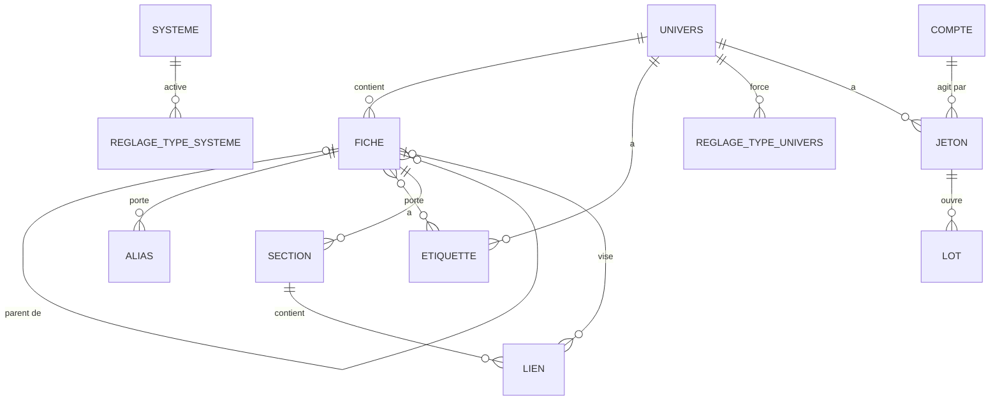

# Kanevas — données

> Doc du produit (voir `docs/parcours.md`, `docs/ecrans.md`). Toutes les entités du produit,
> leurs relations et qui lit ou écrit quoi. **Une tranche ajoute des attributs, jamais une
> entité** : une entité de plus est une question pour le cadrage.

Un seul fichier SQLite sur le volume (`/data/kanevas.db`, AD-5) ; clés étrangères actives, WAL,
une seule connexion d'écriture. Les octets des pièces jointes vont sur le disque du même volume
(`/data/attachments/`), jamais en base (AD-7). Toute lecture et toute écriture passent par les
fonctions de service du backend, que les routes et les outils de l'agent appellent de la même
façon (AD-2).

## Entités

| Entité | Porte | Relations | Qui lit | Qui écrit |
|---|---|---|---|---|
| **compte** | identifiant Authelia (`username`, unique), date de création ; aucun rôle | — | lui-même ; les membres d'un univers commun (son identifiant) ; un MJ qui tape un identifiant exact pour l'ajouter apprend seulement s'il existe ; l'admin d'instance | créé à la première connexion (B-1) |
| **univers** | nom, description, date de création | → système de jeu (facultatif) | ses membres ; son nom : l'admin d'instance | création : tout compte (B-2) ; modification : MJ |
| **membre** | (univers, compte, rôle MJ \| Joueur) | univers, compte | les membres de l'univers ; l'admin d'instance | MJ de l'univers ; admin d'instance (cette table seulement, AD-9) ; au moins un MJ par univers (B-5) |
| **système de jeu** | nom | ← univers ; → gabarits | tout MJ d'un univers (nom seul) ; le contenu : membres d'un univers rattaché | création : tout MJ ; référentiel : MJ d'un univers rattaché |
| **gabarit** | type (règle, créature, objet), nom, contenu | système de jeu | membres d'un univers rattaché | MJ d'un univers rattaché (B-14) |
| **fiche** | type (la liste du produit, AD-102 : personnage, lieu, faction, objet, événement, quête, compte-rendu, et depuis `kanevas-import` créature, race, vaisseau, monde, récit, règle, note), titre, créée le (date d'origine si l'import la donne, B-50), modifiée le, charge utile versionnée par type (AD-6) — personnage : PJ \| PNJ ; compte-rendu : sa campagne ; **illustration** facultative (une image au plus, AD-93) ; *(kanevas-import)* **parent** facultatif (une fiche du même univers, AD-99), **alias**, **étiquettes**, **clé d'origine** facultative | univers ; → sections ; → parent ; ← enfants | qui lit au moins une de ses sections ; sinon elle n'existe pas (B-9) ; son illustration, ses alias, ses étiquettes : qui voit la fiche ; sa clé d'origine : le MJ | création : MJ ; un compte-rendu : tout membre (B-19) ; l'illustration, le titre, le type, le parent, les alias, les étiquettes, la suppression : MJ (B-38 à B-40) |
| **section** | titre, ordre, contenu (Markdown depuis `kanevas-import`, AD-95, avec ses **blocs MJ**, AD-98), modifiée le ; lecture et écriture des joueurs ; auteur (un compte) avec sa lecture et son écriture ; *(kanevas-import)* clé d'origine, version du dernier import | fiche ; → relations, pièces jointes, liens | le MJ ; un joueur selon les bascules (AD-19), **sans ses blocs MJ** | contenu : qui a l'écriture, **un MJ seul si elle contient un bloc MJ** ; structure et audience : MJ |
| **relation** | type (texte libre), dirigée | section porteuse → fiche cible | qui lit la section **et** la fiche cible (sinon la cible n'est pas nommée) | MJ |
| **pièce jointe** | nom d'origine, type MIME, taille, nom sur disque (UUID), secrète | section | qui lit la section, et le MJ seul si secrète | qui écrit la section ; « secrète » : MJ |
| **campagne** | nom, statut (en préparation, active, terminée) | univers ; → scénarios, tâches, CR | tout membre (nom, statut) | MJ |
| **scénario** | titre, contenu | campagne | MJ | MJ |
| **tâche de préparation** | catégorie (monstres, PNJ, cartes, déroulements, autre), libellé, faite | campagne | MJ | MJ |
| **carte** | titre, forme (illustrée \| graphe, fixée à la création), visible des joueurs, fond : une image déposée sur la carte elle-même, rangée sur le disque comme une pièce jointe (AD-40) | univers ; → éléments | MJ ; les joueurs si visible | MJ |
| **élément de carte** | position en % (carte illustrée) ou rien (graphe) | carte, fiche | comme la fiche de l'élément | MJ |
| **lien** *(kanevas-import)* | texte affiché, cible (une fiche, ou une clé d'origine en attente, ou rien : cassé), dans un bloc MJ ou non | section porteuse → fiche cible | comme une relation (AD-64) : la section, hors bloc MJ pour un non-MJ, **et** la cible ; sinon le texte seul | déduit du contenu à chaque écriture de la section (AD-97) ; personne ne l'écrit à part |
| **alias** *(kanevas-import)* | un autre nom de la fiche | fiche | qui voit la fiche | MJ ; l'import |
| **étiquette** *(kanevas-import)* | nom, unique dans l'univers | univers ; ↔ fiches | ses fiches qu'un compte voit ; une étiquette sans fiche visible n'existe pas pour lui | MJ ; l'import (créée au premier usage) |
| **réglage de type** *(kanevas-import)* | un type, activé ou non — au système ; forcé activé ou désactivé — à l'univers ; l'absence veut dire « suit » (AD-102) | système de jeu ou univers | membres d'un univers rattaché (système) ; membres de l'univers (univers) | MJ d'un univers rattaché (système, B-42) ; MJ de l'univers (univers) |
| **jeton d'API** *(kanevas-import)* | nom, empreinte (jamais la valeur), créé le, expire le, révoqué le, dernier usage | univers, compte du MJ qui l'a créé (l'acteur) | les MJ de l'univers (sans la valeur) | création : MJ ; révocation : tout MJ de l'univers (B-45, B-46) |
| **lot d'import** *(kanevas-import)* | ouvert le, clos le, état, compteurs (créées, mises à jour, inchangées, refusées, avertissements), rapport des refus et avertissements | univers, jeton | les MJ de l'univers | le serveur, pour un script qui présente un jeton (B-49) |
| **proposition** | contenu proposé, empreinte du contenu d'origine (la `version` de la section, AD-59), créée le, appliquée le | univers, compte demandeur, section, CR source | son seul demandeur | créée par l'agent du MJ ; appliquée une fois par son demandeur, si la section n'a pas changé (B-21) |

**Index de recherche** : deux index plein texte (FTS5), l'un sur les titres de fiches, l'autre sur les titres et contenus de sections, tenus
à jour par la base (déclencheurs) ; aucune réponse n'en sort sans repasser par le filtre de
droits (AD-8, AD-21).

**Pas de table** pour : les sessions (cookie signé), les conversations avec l'assistant (le fil
vit dans le navigateur, AD-28), la disposition d'un graphe (calculée dans le navigateur, AD-42),
ses liens (déduits des relations, AD-41).

## Assistant (`kanevas-assistant-membre`)

Aucune migration, aucune table, aucun attribut : l'assistant lit et écrit par les fonctions de
service existantes (AD-2, AD-74), et le fil de la conversation n'est stocké nulle part (AD-28,
AD-75). La table `propositions` du cadrage est posée par `kanevas-monde` (ci-dessous).

## Propositions de mise à jour (`kanevas-monde`)

Une table, `propositions` (migration `0008-propositions.sql`, AD-51) :

| Colonne | Type | Contrainte |
|---|---|---|
| `id` | entier | clé |
| `univers_id` | → `univers` | non nul ; sert à refuser une proposition lue sous un autre univers |
| `demandeur_id` | → `comptes` | non nul ; le seul compte qui la lit, l'applique ou l'abandonne (AD-79) |
| `section_id` | → `sections` | non nul ; suppression en cascade avec la section |
| `cr_id` | → `fiches` | non nul ; la fiche de type `compte_rendu` d'où part la proposition ; cascade par précaution (aucune suppression de CR en V1) |
| `contenu_propose` | texte | non nul, non vide, 20 000 caractères au plus (la limite d'une section ; 100 000 depuis `kanevas-import`, AD-106) |
| `version_origine` | entier | non nul ; la `version` que la section avait quand l'assistant l'a lue (AD-59, AD-80) |
| `creee_le` | date | non nul |
| `appliquee_le` | date | nul tant qu'elle est en attente |

Invariants, tenus par la base ou la fonction de service : **une seule proposition en attente par
(demandeur, section)** (index unique partiel sur `appliquee_le IS NULL` ; la nouvelle remplace
l'ancienne dans la même transaction) ; une proposition appliquée ne se réapplique pas ni ne
s'abandonne ; abandonner supprime la ligne ; elle n'est lue que par son demandeur, encore MJ de
l'univers. Aucun autre attribut sur `sections` : la `version` d'AD-59 suffit. Lecture : « périmée »
n'est pas stocké, c'est `version` courante ≠ `version_origine` **tant que la proposition n'est pas appliquée**, calculé à chaque lecture ; une proposition appliquée est toujours « appliquée » (appliquer augmente la `version`).

## Migration 0001 (`kanevas-premiere-fiche`)

Cinq tables : `comptes`, `univers`, `membres`, `fiches`, `sections`. Pas de recherche (FTS5 vient
avec `kanevas-relier-chercher`, qui prend le numéro suivant, AD-51).

| Table | Colonnes (hors clés) | Contraintes |
|---|---|---|
| `comptes` | `id`, `username` (identifiant Authelia, `preferred_username`), `cree_le` | `username` unique ; jamais de rôle ni de groupe (les groupes vivent dans la session) |
| `univers` | `id`, `nom`, `description`, `cree_le` | `nom` non vide, 1 à 80 caractères |
| `membres` | `univers_id`, `compte_id`, `role` (`mj` \| `joueur`) | clé primaire (`univers_id`, `compte_id`) ; clés étrangères ; au moins un `mj` par univers garanti par le service (B-5), pas par la base |
| `fiches` | `id`, `univers_id`, `type` (les sept : `personnage`, `lieu`, `faction`, `objet`, `evenement`, `quete`, `compte_rendu` ; *depuis `kanevas-import`, la liste du produit, sans `CHECK` : AD-102 et « Cadrage `kanevas-import` » plus bas*), `titre`, `charge` (JSON versionné, AD-6 et AD-17 : `{"v":1}` ; personnage `{"v":1,"pj":true\|false}` ; compte-rendu `{"v":1,"campagne_id":…}`), `cree_le`, `modifie_le` | `type` contraint à ces sept valeurs (*contrainte levée par la recréation de `kanevas-import`, AD-102*) ; `titre` non vide, 1 à 120 caractères ; **aucune suppression** (*suppression par le MJ depuis `kanevas-import`, AD-105*) |
| `sections` | `id`, `fiche_id`, `titre`, `ordre`, `contenu` (texte brut, AD-58 ; 20 000 caractères au plus, AD-91), `version` (entier, AD-59, 1 à la création), `modifie_le`, `joueurs_lisent`, `joueurs_ecrivent`, `auteur_id` (compte, facultatif), `auteur_lit`, `auteur_ecrit` | quatre bascules booléennes, **toutes à faux à la création** (une section naît fermée aux joueurs) ; `ordre` entier unique par fiche ; `titre` non vide, 1 à 80 caractères ; `contenu` borné par le service seul (`MAX_CONTENU_SECTION`), pas par un `CHECK` ; `auteur_id` doit être un membre Joueur de l'univers de la fiche, vérifié par le service ; retirer un membre efface son `auteur_id` |

`modifie_le` de la fiche suit la dernière écriture d'une de ses sections. `ordre` est renuméroté
de 1 à n à chaque réordonnancement ou retrait. Le mode Joueur est calculé par le service, jamais
par le client : il lit comme un Joueur **qui n'est l'auteur d'aucune section** (AD-39).

## `kanevas-recours-admin` : aucune migration

Aucune table, aucune colonne : l'admin d'instance n'est pas une donnée (AD-9). Sa seule lecture hors
des univers dont il est membre : le nom de chaque univers et le nombre de ses membres, puis la liste
des membres d'un univers (identifiant, rôle) ; son seul geste : ajouter, changer le rôle, retirer un
membre (B-6). Il ne lit ni ne modifie jamais la description, les fiches ou rien d'autre.
## Migration `kanevas-systemes`

> Fichier : `src/db/migrations/0002-systemes.sql` — **numéro provisoire** (0002).
>
> Pendant le build, le fichier prend le numéro qui suit le dernier présent sur la branche : **numéro
> provisoire**. Il n'est définitif qu'à la fusion : la phase merge (l'étape de la chaîne qui fusionne les PR après la recette) le recale sur le dernier fusionné si
> une autre tranche est entrée avant (AD-51), et corrige alors cette note. Deux tables, une colonne : aucune entité de plus que le cadrage.

| Table | Colonnes (hors clés) | Contraintes |
|---|---|---|
| `systemes_jeu` | `id`, `nom`, `cree_le` | `nom` 1 à 80 caractères après rognage ; **unique sans tenir compte de la casse** (`COLLATE NOCASE`) |
| `gabarits` | `id`, `systeme_id`, `type` (`regle` \| `creature` \| `objet`), `nom`, `contenu` (texte brut, AD-58), `version` (entier, 1 à la création, AD-85), `cree_le`, `modifie_le` | `type` contraint à ces trois valeurs, fixé à la création ; `nom` 1 à 120 caractères ; `contenu` 20 000 au plus ; `nom` unique par (système, type) sans tenir compte de la casse ; **aucune suppression** |
| `univers` (ajout) | `systeme_id`, facultatif, → `systemes_jeu` | `NULL` par défaut (aucun univers existant n'est rattaché) |

Un univers a **au plus un** système ; un système peut servir plusieurs univers. Détacher remet
`systeme_id` à `NULL` et ne touche à aucun gabarit. Rien n'est amorcé hors bouchon : le catalogue naît vide, les
systèmes sont créés par les MJ. En bouchon seulement, le semis de démonstration crée « CoF Mini » et
« Chroniques Oubliées Fantasy » (`src/bouchon/depart.ts`).

**Droits** (AD-25) : le catalogue (`id`, `nom`) se lit par tout compte qui est MJ d'au moins un univers ;
un système, ses gabarits et le nombre d'univers qui l'utilisent se lisent par les membres d'un
univers rattaché ; les gabarits s'écrivent par ses MJ. **Le nombre N est le seul renseignement sur les
autres univers** : ni leur nom, ni leurs membres (règle 3). Créer un système : tout MJ d'un univers,
au catalogue, avec ou sans rattachement dans le même geste. Modifier le nom et la description d'un
univers : MJ. Depuis `kanevas-illustrations` (AD-94), un système se lit à sa propre adresse, sous la même
garde (rattaché à un univers dont le compte est membre ; écrire : MJ d'un de ces univers) : aucune
colonne ni table de plus.

## Migration `kanevas-suivi` (numéro pris à la fusion, AD-51 : le suivant de 0002)

> Fichier : `src/db/migrations/0003-suivi.sql` — **numéro provisoire** (0003), recalé à la fusion si une autre tranche entre avant (AD-51).

Trois tables, aucune entité nouvelle (campagne, scénario, tâche de préparation sont celles du
cadrage). Les comptes-rendus n'ont pas de table : un compte-rendu est une fiche de type
`compte_rendu` (charge `{"v":1,"campagne_id":…}`, déjà posée par 0001, AD-52).

| Table | Colonnes (hors clés) | Contraintes |
|---|---|---|
| `campagnes` | `id`, `univers_id`, `nom`, `statut` (`en_preparation` \| `active` \| `terminee`), `cree_le` | `nom` non vide, 1 à 80 caractères ; `statut` contraint à ces trois valeurs, `en_preparation` à la création ; plusieurs `active` permises (AD-60) ; **aucune suppression** |
| `scenarios` | `id`, `campagne_id`, `titre`, `contenu` (texte brut, AD-58), `version` (entier, 1 à la création, AD-62), `cree_le`, `modifie_le` | `titre` non vide, 1 à 120 caractères ; `contenu` 20 000 caractères au plus ; **aucune suppression** |
| `taches_preparation` | `id`, `campagne_id`, `categorie` (`monstres` \| `pnj` \| `cartes` \| `deroulements` \| `autre`), `libelle`, `faite`, `faite_le` (date de la dernière coche, vide si décochée), `cree_le` | `libelle` non vide, 1 à 200 caractères ; catégorie contrainte à ces cinq valeurs (AD-46) ; **aucune suppression** |

Un compte-rendu se crée en une seule transaction : la fiche (type `compte_rendu`, `campagne_id` de
la campagne de l'univers) et **une** section « Compte-rendu » portant le texte, lisible des
joueurs, non écrivable par eux ; si le créateur est un Joueur, il en est l'auteur, qui la lit et
l'écrit ; si c'est un MJ, la section n'a pas d'auteur (AD-61). La campagne cible doit appartenir à
l'univers du créateur, sinon la création échoue comme pour une campagne inconnue. Rien n'est écrit
si l'une des deux écritures échoue. L'ordre des comptes-rendus est `cree_le` décroissant, `id`
décroissant en cas d'égalité. Le nom de la campagne et l'auteur d'un compte-rendu se lisent à
travers les droits de la fiche : l'auteur n'est montré que si la section est lisible du compte.

Droits (en plus de ceux de 0001) : `campagnes` — nom et statut, tout membre de l'univers ; création
et statut, MJ. `scenarios` et `taches_preparation` — MJ de l'univers **de la campagne** seul (AD-47),
évalué sur l'univers de la campagne, jamais sur un identifiant fourni par l'appelant : un MJ d'un
autre univers n'atteint aucun scénario ni aucune tâche, un Joueur non plus (réponse comme pour un
identifiant inconnu, AD-22), et leur nombre ni leur existence ne sortent jamais d'une réponse à
un Joueur.

## Règles de droits, en une phrase chacune

1. Les droits sur le contenu viennent de **membre**, jamais d'Authelia (AD-9). Authelia ne
   donne qu'une chose : le rôle d'admin d'instance (groupe `parents`), qui lit les noms des
   univers et les membres, et n'écrit que la table des membres.
2. Le **MJ** lit et écrit tout dans son univers (AD-18) ; un **joueur** suit les bascules de
   chaque section (AD-19).
3. Ce qu'un compte ne peut pas lire **n'existe pas** pour lui : absent des listes, des
   recherches, des cartes, des liens ; son adresse répond 404 (AD-22).
4. Une **pièce jointe** n'est servie que par la route qui revérifie ces droits (AD-7, AD-36).
5. L'**agent** a exactement les droits de la personne qui lui parle (AD-2, AD-26).
6. L'**illustration** d'une fiche se voit par qui voit la fiche et se pose par le MJ seul ; elle
   n'est jamais secrète (AD-93).
7. *(kanevas-import)* Un **bloc MJ** n'existe que pour un MJ hors mode Joueur : ni sur la fiche, ni dans
   l'index qu'un non-MJ interroge, ni dans un lien entrant, ni dans une image (AD-98).
8. *(kanevas-import)* Un **lien** ou un **lien entrant** se lit sous les deux gardes d'une relation :
   la section qui le porte, la fiche qu'il vise ; sinon seul le texte de l'auteur reste (AD-97, AD-100).
9. *(kanevas-import)* Un **jeton d'API** agit avec les droits du MJ qui l'a créé, dans son seul
   univers, sur la seule API d'import ; perdre le rôle, c'est perdre le jeton (AD-103).

## Migration `kanevas-relier-chercher` (`0005-relier-chercher.sql`, recalée à la fusion après 0004, AD-51)

Une table et deux index de recherche ; aucune entité nouvelle (la relation est celle du cadrage).

| Objet | Colonnes (hors clés) | Contraintes |
|---|---|---|
| `relations` | `id`, `section_id` (la porteuse), `cible_fiche_id`, `type` (texte libre), `cree_le` | `section_id` → `sections` **ON DELETE CASCADE** (retirer une section retire ses relations) ; `cible_fiche_id` → `fiches` **ON DELETE RESTRICT** (une fiche ne se supprime pas) ; `type` 1 à 80 caractères après rognage ; `UNIQUE (section_id, cible_fiche_id, type)` |
| `recherche_fiches` (FTS5) | `titre` ; `rowid` = `fiches.id` | tokenizer `unicode61 remove_diacritics 2` |
| `recherche_sections` (FTS5) | `titre`, `contenu` ; `rowid` = `sections.id` | idem |

Les index sont tenus par des **déclencheurs** (AD-21) : à l'insertion, à la modification du titre
(fiche) ou du titre et du contenu (section), à la suppression, y compris celle qu'une cascade
provoque. La migration **remplit** les index depuis les lignes déjà présentes (une base de la
première fiche garde ses fiches cherchables). Index SQL : `relations (section_id)` sert la lecture
des relations d'une section ; aucun index sur `cible_fiche_id` (aucune requête de cette tranche n'en
a besoin ; le graphe des cartes ajoutera le sien si sa requête l'exige).

Ce que la base ne dit pas, et que le service porte, avec sa raison (la règle croise plusieurs
tables) : la fiche cible est **du même univers** que la fiche de la section ; elle n'est **pas**
cette fiche elle-même ; une section porte **100 relations** au plus ; seul un MJ crée ou retire.

Lecture, évaluée pour **le compte et le mode** de l'appelant : une relation est rendue si la section
porteuse est lisible **et** si la fiche cible l'est (au moins une section lisible ; le MJ, hors
mode Joueur, lit toute fiche de son univers). Sinon elle est absente de la réponse, sans compteur.
Recherche : la liste d'un type avec une condition de plus (AD-63), saisie de 1 à 100 caractères (le service refuse au-delà) ; l'API accepte `q` sans `type` (toutes les fiches lisibles), mais aucun écran ne l'emploie : la recherche tous types reste hors tranche ; l'index ne livre que des
identifiants de candidats, jamais un résultat.

## Évolution

Migrations SQL numérotées, appliquées au démarrage, sans ORM (AD-14). *Remplacé par `kanevas-import`
(AD-102) :* ~~**La table des fiches connaît ses sept types dès sa création** : aucune tranche ne la
recrée.~~ La table des fiches est **recréée une fois**, par `kanevas-import`, pour lever la contrainte
sur le type ; ensuite un type s'ajoute dans le code seul (voir plus bas). L'ordre des migrations
suit l'ordre de fusion des tranches, et chaque tranche prend le numéro suivant au moment où elle
se fusionne, pas avant (AD-51).

## Migration `kanevas-fichiers` (numéro pris à la fusion, AD-51 : le suivant de 0003)

> Provisoire comme celle des systèmes ci-dessus. Fichier : `src/db/migrations/0004-pieces-jointes.sql` — **numéro provisoire** (0004), recalé à la
> fusion si une autre tranche est entrée avant (AD-51). Code : `src/services/stockage.ts` (octets,
> sans notion de section) et `src/services/pieces-jointes.ts` ; dossier réglable par `ATTACHMENTS_DIR`
> (défaut : `attachments/` à côté de la base).

Une table ; aucune entité nouvelle (la pièce jointe est celle du cadrage). Les octets ne sont pas
en base (AD-7) : ils vivent sous `/data/attachments/`.

| Objet | Colonnes (hors clés) | Contraintes |
|---|---|---|
| `pieces_jointes` | `id`, `section_id`, `nom` (nom d'origine), `type` (type MIME **déterminé par le serveur**, AD-66), `taille` (octets), `fichier` (nom sur disque, UUID, AD-35), `secrete` (booléen), `cree_le` | `section_id` → `sections` **ON DELETE CASCADE** (retirer une section retire ses lignes) ; `fichier` unique ; `nom` 1 à 200 caractères ; `taille` > 0 ; `secrete` faux à la création sauf demande du MJ ; index `pieces_jointes (section_id)` |

**Sur le disque** : `/data/attachments/<fichier>` (un fichier plat par pièce, nom = UUID) ; les envois
en cours s'écrivent dans `/data/attachments/tmp/` puis passent d'un coup à leur nom définitif
(AD-65) ; le dossier `tmp/` est vidé au démarrage (sauf base en mémoire). Une ligne et son fichier vont ensemble : jamais
de ligne sans fichier, et un fichier sans ligne n'est pas atteignable (nom aléatoire, aucune route
statique).

Ce que la base ne dit pas, et que le service porte, avec sa raison (la règle croise la section, le
rôle et le mode) : **50 pièces jointes** au plus par section ; ajouter ou retirer demande
d'**écrire** la section ; `secrete` ne se pose et ne se lève que par un MJ ; une pièce se **lit** si
la section est lisible et, si elle est secrète, par un MJ hors mode Joueur ; un fichier vide est refusé.
Ajouter ou retirer une pièce ne change ni la `version` ni `modifie_le` de la section (ce n'est
pas une écriture de son contenu, AD-59).

Retirer une pièce, ou une section, supprime la ligne **puis** le fichier du disque ; si la
suppression du fichier échoue, la ligne est déjà partie et l'orphelin est inatteignable (risque
accepté : il n'y a pas de balayage des orphelins en V1).

## Migration `kanevas-cartes-graphes` (`0007-cartes.sql`, numéro provisoire recalé à la fusion si une autre tranche entre avant, AD-51)

Deux tables ; aucune entité nouvelle (la carte et l'élément de carte sont ceux du cadrage). Les
octets d'un fond ne sont pas en base (AD-7) : ils vivent sous `/data/attachments/` (AD-69).

| Table | Colonnes (hors clés) | Contraintes |
|---|---|---|
| `cartes` | `id`, `univers_id`, `titre`, `forme` (`illustree` \| `graphe`), `visible` (booléen), `fond` (nom sur disque, UUID, facultatif), `fond_type` (type MIME déterminé par le serveur), `cree_le` | `univers_id` → `univers` ; `titre` non vide, 1 à 80 caractères ; `forme` contrainte à ces deux valeurs et **jamais modifiée** ; `visible` **faux à la création** ; `fond` et `fond_type` ensemble ou ensemble absents, et absents d'un graphe (`CHECK`) ; `fond` unique ; index `cartes (univers_id)` ; **aucune suppression** |
| `elements_carte` | `id`, `carte_id`, `fiche_id`, `x`, `y` (réels, pourcentage, AD-70), `cree_le` | `carte_id` → `cartes` ; `fiche_id` → `fiches` **ON DELETE RESTRICT** (une fiche ne se supprime pas) ; `UNIQUE (carte_id, fiche_id)` ; `x` et `y` ensemble nuls ou ensemble entre 0 et 100 (`CHECK`) |

Ce que la base ne dit pas, et que le service porte, avec sa raison (la règle croise la carte, la
fiche et le rôle) : la fiche d'un élément est **du même univers** que la carte ; une carte
**illustrée** porte des éléments avec position, un **graphe** des éléments sans position ; **100
éléments** au plus par carte (AD-72) ; seul un MJ hors mode Joueur crée une carte, la règle (titre,
visibilité), change son fond, place, déplace ou retire un élément ; un fond n'est qu'une image de
25 Mo au plus (AD-69). Retirer un élément supprime sa ligne, jamais la fiche.

Lecture, évaluée pour **le compte et le mode** de l'appelant (AD-68) : une carte se lit si le
compte est MJ hors mode Joueur, ou si elle est visible. Un élément est rendu si sa fiche est lisible
(au moins une section lisible ; le MJ hors mode Joueur lit toute fiche de son univers, AD-38). Les
liens d'un graphe ne sont pas stockés (AD-41) : pour deux éléments rendus A et B, un lien « A → B,
type » existe pour chaque relation de `relations` portée par une section de A que le lecteur lit, qui
vise B et qui se lit sous les deux gardes d'AD-64 (par la même fonction de lecture des relations que
la fiche). Un lien n'est rendu que si ses deux bouts le sont. Aucune réponse ne dit combien
d'éléments ou de liens ont été écartés. La liste des cartes d'un joueur ne contient que les cartes
visibles ; un MJ en mode Joueur voit la même.

## Migration `kanevas-illustrations` (numéro pris à la fusion, AD-51)

> Fichier : `src/db/migrations/0006-illustrations.sql` — **numéro provisoire**, celui qui suit le dernier
> présent sur la branche, recalé à la fusion si une autre tranche
> est entrée avant (AD-51). Décision : AD-93.

**Conceptuel.** Une fiche a **zéro ou une** illustration : une image (PNG, JPEG, GIF ou WebP)
choisie par le MJ pour la représenter dans la liste (E-8) et en tête de la fiche (E-9). Ce n'est
pas une pièce jointe : elle n'appartient à aucune section, n'en prend pas la visibilité et n'a
pas de nom d'origine à montrer. Invariants : (1) une fiche a au plus une illustration ; (2) une
illustration est entière ou absente — son fichier, son type et sa taille vont ensemble ; (3) son
type est l'un des quatre types d'image servis en ligne (AD-66) ; (4) un fichier sur le disque
n'appartient qu'à une illustration.

**Logique : trois colonnes sur `fiches`, pas de table.** La cardinalité « au plus une » est celle
d'une colonne : une table liée devrait la reconstruire par un `UNIQUE (fiche_id)` et ajouterait
une entité que le cadrage n'a pas (« une tranche ajoute des attributs, jamais une entité »).

| Colonne (ajout à `fiches`) | Type | Absence (`NULL`) | Contrainte (invariant) |
|---|---|---|---|
| `illustration_fichier` | texte : nom sur disque, un UUID (AD-35) | la fiche n'a pas d'illustration | index unique `fiches_illustration_fichier` (4) — `ALTER TABLE … ADD COLUMN` ne peut pas porter `UNIQUE`, d'où l'index ; plusieurs `NULL` y sont permis |
| `illustration_type` | texte : type MIME **déterminé par le serveur** à la signature (AD-66) | idem | `CHECK (illustration_type IN ('image/png','image/jpeg','image/gif','image/webp'))` (3) |
| `illustration_taille` | entier : octets | idem | `CHECK (illustration_taille > 0 AND (illustration_fichier IS NULL) = (illustration_type IS NULL) AND (illustration_type IS NULL) = (illustration_taille IS NULL))` (2) ; (1) tient par construction |

Vérifié sur SQLite 3.46 : `ADD COLUMN` accepte ces `CHECK` (qui peuvent nommer une colonne déjà
présente), les lignes existantes (toutes `NULL`) les passent, un triplet incomplet ou un type
`image/svg+xml` est refusé. Pas de clé étrangère (rien n'est référencé), donc pas d'`ON DELETE` ;
les fiches ne se suppriment pas (migration 0001).

**Physique.** Même base, mêmes réglages (WAL, `foreign_keys`). Les octets vont sur le disque, par
le module de stockage d'AD-65, dans le même dossier que les pièces jointes
(`/data/attachments/<illustration_fichier>`), jamais en base (AD-7). Index : seulement l'index
unique ci-dessus, qui porte l'invariant (4) ; aucune requête ne cherche une fiche par son
illustration. La liste E-8 lit les colonnes avec la ligne de la fiche qu'elle lit déjà.

**Plan de migration.** Un seul temps, **élargir** : trois colonnes nullables et un index, aucune
donnée reprise, aucune colonne lue par l'ancien code. Le code de la tranche part avec elle ; un
retour arrière laisse des colonnes ignorées. Rien à resserrer. Multi-tenant : inchangé (la fiche
est déjà dans son univers).

**Écrire.** Poser et remplacer : le serveur écrit le flux dans `tmp/`, lit sa signature, le
déplace à son nom définitif, puis **dans une transaction** revérifie que le compte est MJ de
l'univers de la fiche et écrit les trois colonnes ; **après** la validation, il supprime le
fichier remplacé. Retirer : remet les trois colonnes à `NULL`, puis supprime le fichier. Un échec
ou une annulation n'écrit ni colonne ni fichier ; un fichier remplacé ou retiré dont la
suppression échoue reste orphelin et inatteignable (même risque accepté que les pièces jointes).
Poser, remplacer ou retirer ne change pas `modifie_le` de la fiche (ce n'est pas une écriture de
ses sections). Le dossier `tmp/` est vidé au démarrage, comme pour les pièces jointes.

**Droits, une phrase chacun.**
- **Voir** l'illustration : qui voit la fiche (au moins une section lisible ; le MJ, toute fiche de
  son univers), selon ses droits réels — le mode Joueur d'un MJ ne change que ce que l'écran montre.
- **Poser, remplacer, retirer** : un MJ de l'univers de la fiche ; un Joueur ne le peut pas, même
  auteur ou rédacteur d'une section.
- **Jamais secrète** : elle est au niveau de la fiche, comme son titre ; qui voit le titre voit
  l'illustration.
- **Fiche invisible** : son illustration n'existe pas pour le compte (réponse identique à un
  identifiant inconnu, AD-22, AD-67).

## Cadrage `kanevas-import` : le modèle

> Proposé le 2026-10-11 (`epic/kanevas-import`). Décisions : AD-95 à AD-109 (AD-109 `[À TRANCHER]`). Six entités nouvelles —
> lien, alias, étiquette, réglage de type, jeton d'API, lot d'import — et des attributs sur fiche,
> section, pièce jointe, campagne, scénario, carte. Les tranches de l'epic ajouteront des attributs,
> jamais une entité. Numéros de migration : pris à la fusion (AD-51) ; les noms ci-dessous sont
> provisoires.

### Conceptuel

Invariants, en phrases :
1. Le parent d'une fiche est une autre fiche **du même univers**, et une fiche n'est jamais son
   propre ancêtre (pas de cycle).
2. Une **clé d'origine** désigne au plus une fiche par univers, au plus une section par fiche, au plus
   une pièce jointe par section, une campagne par univers, un scénario par campagne, une carte par
   univers.
3. Un identifiant de fiche n'est **jamais réemployé** : un lien `[[42|…]]` vers une fiche supprimée
   reste cassé, il ne vise jamais une autre fiche.
4. Un lien vise une fiche, ou attend une clé d'origine, ou est cassé — jamais deux à la fois.
5. Un type de fiche appartient à la liste du produit ; un réglage de type n'existe que pour un type
   de cette liste, au plus un par (système, type) et par (univers, type).
6. Une étiquette porte un nom unique dans son univers, sans tenir compte de la casse ; un alias est
   unique par fiche, de même.
7. Un jeton appartient à un univers et à un compte qui y était MJ à sa création ; sa valeur n'est
   jamais stockée, seule son empreinte, unique.
8. Le contenu public d'une section est son contenu **sans ses blocs MJ** ; il est toujours celui du
   contenu courant.
9. Une section qui contient un bloc MJ n'est écrite que par un MJ.
10. Supprimer une fiche ne laisse aucune ligne qui la vise : ses sections (et ce qu'elles portent),
    les relations et éléments de carte qui la visent partent ; ses enfants remontent sous son parent ;
    les liens qui la visent deviennent cassés.
11. Supprimer un univers ne laisse aucune ligne qui le vise (le système de jeu n'est pas à lui).

### Logique

**`fiches`, recréée une fois** (la seule recréation de table du produit, AD-102) :

| Colonne | Changement | Contrainte (invariant) |
|---|---|---|
| `type` | le `CHECK` des sept valeurs est **levé** | validé par le service contre la liste du code (5) — la base ne peut plus le garantir : c'est le prix d'un type sans migration, choisi par Monsieur |
| `parent_id` | nouvelle, → `fiches`, **ON DELETE SET NULL** ; nul : la fiche est à la racine | (1) même univers et pas de cycle : **service** (la règle traverse la table ; un déclencheur récursif est rejeté, AD-99) ; `CHECK (parent_id <> id)` |
| `cle_origine` | nouvelle, texte 1 à 200 ; nulle : fiche née dans Kanevas | (2) index unique `(univers_id, cle_origine)` (plusieurs `NULL` permis) |
| `cree_le`, `modifie_le` | inchangées ; `cree_le` peut venir de l'import (B-50) | — |
| `illustration_empreinte` | nouvelle, SHA-256 de l'illustration ; nulle avec elle | ensemble avec les trois colonnes d'illustration (`CHECK` étendu) ; sert à ne pas renvoyer une illustration inchangée (AD-104) |
| `id` | `AUTOINCREMENT` gardé | (3) — vérifié dans `0001-premiere-fiche.sql` : SQLite ne réemploie pas un identifiant `AUTOINCREMENT` |

Les autres colonnes et index (illustration, AD-93) sont recopiés tels quels ; les déclencheurs de
`recherche_fiches` sont recréés.

**Tables nouvelles :**

| Table | Colonnes (hors clés) | Contraintes |
|---|---|---|
| `fiche_alias` | `fiche_id`, `alias` | → `fiches` ON DELETE CASCADE ; `alias` 1 à 120 ; `UNIQUE (fiche_id, alias COLLATE NOCASE)` (6) ; 20 au plus par fiche : service |
| `etiquettes` | `id`, `univers_id`, `nom`, `cree_le` | → `univers` ; `nom` 1 à 40 ; `UNIQUE (univers_id, nom COLLATE NOCASE)` (6) |
| `fiche_etiquettes` | `fiche_id`, `etiquette_id` | clé primaire des deux ; → `fiches` et → `etiquettes` ON DELETE CASCADE ; même univers : service ; 20 au plus par fiche : service |
| `liens` | `id`, `section_id`, `cible_fiche_id` (nul si en attente ou cassé), `cible_cle` (nulle sauf en attente), `texte`, `dans_bloc_mj` (booléen) | → `sections` ON DELETE CASCADE ; `cible_fiche_id` → `fiches` **ON DELETE SET NULL** (la fiche supprimée laisse un lien cassé, 10) ; `CHECK (cible_fiche_id IS NULL OR cible_cle IS NULL)` (4) ; index `liens (cible_fiche_id)` et `liens (cible_cle)` |
| `types_systeme` | `systeme_id`, `type`, `active` (booléen) | clé primaire `(systeme_id, type)` (5) ; → `systemes_jeu` ; l'absence d'une ligne : le défaut du produit (activé) |
| `types_univers` | `univers_id`, `type`, `active` (booléen) | clé primaire `(univers_id, type)` (5) ; → `univers` ; l'absence d'une ligne : l'univers suit son système |
| `jetons_api` | `id`, `univers_id`, `compte_id`, `nom`, `empreinte`, `cree_le`, `expire_le`, `revoque_le` (nul : actif), `dernier_usage_le` (nul : jamais) | → `univers`, → `comptes` ; `empreinte` unique (7) ; `nom` 1 à 80 ; `CHECK (expire_le > cree_le)` ; un an au plus : service |
| `lots_import` | `id`, `univers_id`, `jeton_id`, `ouvert_le`, `clos_le` (nul : en cours), `dernier_ecrit_le`, `creees`, `mises_a_jour`, `inchangees`, `refusees`, `avertissements` (entiers ≥ 0), `rapport` (JSON : 1 000 entrées au plus, `{cle, objet, raison, gravite}`) | → `univers`, → `jetons_api` ; « abandonné » n'est pas stocké : ouvert et `dernier_ecrit_le` de plus de 24 h |

**Colonnes ajoutées** (`ALTER TABLE … ADD COLUMN`, comme 0002 et 0006) :

| Table | Colonnes | Contrainte |
|---|---|---|
| `sections` | `contenu_public` (texte ; le contenu sans blocs MJ), `cle_origine` (nulle : née dans Kanevas), `version_importee` (entier ; nul : jamais écrite par un import) | (8) écrit par le service dans la même transaction que `contenu` (AD-98) — une fonction Markdown ne s'écrit pas en SQL ; index unique `(fiche_id, cle_origine)` (2) |
| `pieces_jointes` | `cle_origine`, `empreinte` (SHA-256 des octets, pour ne pas renvoyer une image inchangée) | index unique `(section_id, cle_origine)` (2) |
| `campagnes`, `cartes` | `cle_origine` | index unique `(univers_id, cle_origine)` (2) |
| `scenarios` | `cle_origine` | index unique `(campagne_id, cle_origine)` (2) |

**Ce que la base ne dit pas, et que le service porte**, avec sa raison : même univers pour parent,
étiquette, cible de lien et de relation (la règle croise deux tables) ; pas de cycle (récursif) ; le
type dans la liste du code (choix de Monsieur, ci-dessus) ; l'écriture d'une section à bloc MJ par un
MJ seul (croise le contenu et le rôle, 9) ; le contenu public (Markdown) ; un jeton créé par un MJ, et
encore MJ à chaque usage (le rôle change sans toucher au jeton). **Supprimer** (10, 11) : une
fonction de service par geste, une transaction, qui supprime dans l'ordre ce qui vise la fiche ou
l'univers ; les clés étrangères existantes, sans `ON DELETE` ou en `RESTRICT` (`relations.cible_fiche_id`,
`elements_carte.fiche_id`, tout `univers_id`), **restent** : un oubli du service fait échouer la
transaction au lieu de laisser une ligne orpheline. Les fichiers (pièces, illustrations, fonds) se
suppriment du disque **après** la validation ; un échec laisse un orphelin inatteignable (risque déjà
accepté, `kanevas-fichiers`).

**Droits, une phrase chacun** (en plus des règles ci-dessus) : alias et étiquettes se voient par qui
voit la fiche, s'écrivent par le MJ ; une étiquette est proposée à un compte si elle porte au moins une
fiche qu'il voit ; un réglage de type de système s'écrit par un MJ d'un univers rattaché, se lit par
les membres des univers rattachés ; un réglage d'univers s'écrit par un MJ de l'univers ; un jeton et
un lot se lisent par les MJ de l'univers, un jeton se révoque par tout MJ de l'univers ; la clé
d'origine se lit par le MJ.

### Physique

Même base, mêmes réglages (WAL, `foreign_keys`, une connexion d'écriture, AD-5). Index et la requête
qu'ils servent : `fiches (parent_id)` — les enfants (bloc « Contient », arbre de E-8) et le
re-parentage à la suppression ; `fiches (univers_id, cle_origine)` unique — la recherche d'une fiche par
clé à chaque appel de l'API ; `liens (cible_fiche_id)` et **`relations (cible_fiche_id)`** (absent
jusqu'ici) — « Mentionnée dans » (AD-100) et la suppression ; `liens (cible_cle)` — la résolution des
liens en attente à la création d'une fiche ; `fiche_etiquettes (etiquette_id)` — le filtre par étiquette
de E-17 ; `jetons_api (empreinte)` unique — l'authentification de chaque requête de l'API ;
`lots_import (univers_id, ouvert_le)` — la liste de E-18. **Index de recherche** recréés :
`recherche_fiches (titre, alias)` (l'alias concaténé, tenu par des déclencheurs sur `fiches` et
`fiche_alias`) et `recherche_sections (titre, contenu_public, contenu)` : un non-MJ (ou un MJ en mode
Joueur) cherche dans `titre` et `contenu_public`, un MJ dans `titre` et `contenu` (filtre de colonnes
FTS5, AD-101). Les déclencheurs restent la seule source des index (AD-21) ; le service n'écrit que
`contenu_public`, que les déclencheurs indexent.

**Multi-tenant** : inchangé — tout est dans un univers ; chaque table nouvelle porte `univers_id` ou
pend d'une ligne qui le porte, et toute requête filtre dessus. Un système de jeu reste hors des univers.

### Plan de migration

1. **Élargir** (une migration, la tranche des types) : recréer `fiches` sans `CHECK` sur le type, avec
   `parent_id` et `cle_origine` — procédure SQLite de recréation (nouvelle table, copie, suppression,
   renommage, index et déclencheurs recréés, `PRAGMA foreign_key_check` vide). **Fait porteur** :
   l'exécuteur de migrations ouvre une transaction par fichier avec `foreign_keys` actif
   (`src/db/db.ts:18` et `:50`), et SQLite ignore `PRAGMA foreign_keys` dans une transaction ; supprimer
   `fiches` sous clés actives échouerait (sections, relations, éléments de carte, propositions la
   visent). La tranche doit donc apprendre à l'exécuteur à jouer **ce** fichier clés coupées, puis à
   vérifier `foreign_key_check` avant de valider. Comptage des lignes avant et après, sur une copie de
   la base de production (`/mnt/data/kanevas/data/kanevas.db`).
2. **Élargir** (une migration par tranche qui en a besoin) : les tables nouvelles et les colonnes
   ajoutées, toutes nullables ou avec défaut ; aucune donnée reprise, sauf `contenu_public = contenu`
   pour les sections existantes (aucun bloc MJ n'existait : la syntaxe `:::mj` est nouvelle) et le
   remplissage des index de recherche recréés.
3. **Migrer** : sans objet — aucun ancien lecteur ne survit (frontend et backend partent dans la même
   image). Les contenus en texte brut sont **relus comme du Markdown** (AD-95, `[À TRANCHER]` à sa
   place).
4. **Resserrer** : rien à resserrer ; aucune colonne n'est retirée.

Retour arrière : une image d'avant la recréation de `fiches` relit la table (mêmes colonnes et plus) ;
les types ajoutés lui seraient inconnus — une fiche d'un type nouveau ne s'afficherait pas dans
l'ancienne image. Restaurer la sauvegarde du volume d'avant la mise à jour reste le retour complet.
