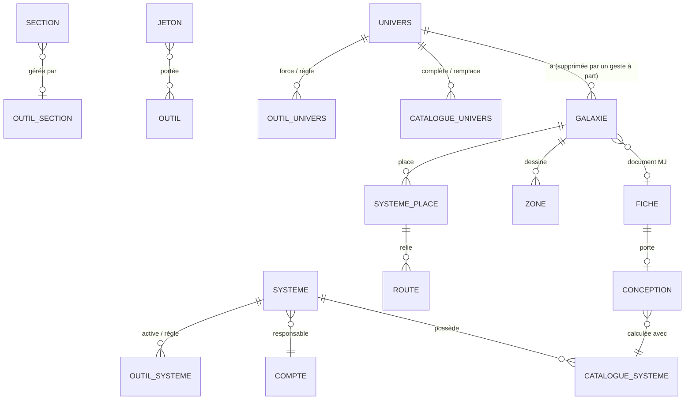

# Kanevas — data

> Product documentation (see `docs/parcours.md`, `docs/ecrans.md`). All product entities,
> their relationships and who reads or writes what. **A slice adds attributes; an extra
> entity is a scoping decision**, made before the slice (this is how maps, proposals and
> attachments came about), never along the way.

A single SQLite file on the volume (`/data/kanevas.db`, AD-5); foreign keys enabled, WAL,
a single write connection. Attachment bytes live on disk on the same volume
(`/data/attachments/`), never in the database (AD-7). Every read and write goes through the
backend service functions, called in the same way by routes and agent tools
(AD-2).

## Entities

| Entity | Holds | Relationships | Who reads | Who writes |
|---|---|---|---|---|
| **account** | Authelia identifier (`username`, unique), creation date; no role | — | the account itself; members of a shared universe (its identifier); a GM entering an exact identifier to add it learns only whether it exists; the instance admin | created at first sign-in (B-1) |
| **universe** | name, description, creation date | → game system (optional) | its members; its name: the instance admin | creation: any account (B-2); update: GM |
| **member** | (universe, account, GM \| Player role) | universe, account | universe members; the instance admin | universe GM; instance admin (this table only, AD-9); at least one GM per universe (B-5) |
| **game system** | name | ← universes; → templates | any universe GM (name only); content: members of an attached universe | creation: any GM; reference content: GM of an attached universe |
| **template** | type (rule, creature, item), name, content | game system | members of an attached universe | GM of an attached universe (B-14) |
| **sheet** | type (the product list, AD-102: character, location, faction, item, event, quest, session report, and since `kanevas-import` creature, race, ship, lore, story, rule, note), free-form **subtype** (B-52), title, creation date (original date if provided by the import, B-50), update date, payload versioned by type (AD-6) — character: PC \| NPC; session report: its campaign; optional **illustration** (at most one image, AD-93); *(kanevas-import)* optional **parent** (a sheet in the same universe, AD-99), **aliases**, **labels**, optional **origin key** | universe; → sections; → parent; ← children | anyone who reads at least one of its sections; otherwise it does not exist (B-9); its illustration, aliases, labels: anyone who sees the sheet; its origin key: the GM | creation: GM; a session report: any member (B-19); illustration, title, type, subtype, parent, aliases, labels, deletion: GM (B-38 to B-40, B-52) |
| **section** | title, order, content (Markdown since `kanevas-import`, AD-95, with its **GM blocks**, AD-98), update date; player read and write permissions; author (an account) with their read and write permissions; *(kanevas-import)* origin key, last import version | sheet; → relations, attachments, links | the GM; a player according to the toggles (AD-19), **without its GM blocks** | content: anyone with write permission, **a GM only if it contains a GM block**; structure and audience: GM |
| **relation** | type (free text), directed | carrying section → target sheet | anyone who reads the section **and** the target sheet (otherwise the target is not named) | GM |
| **file** *(kanevas-import, media library, AD-111)* | name, type (detected by signature; image if PNG, JPEG, GIF, WebP, document otherwise), size, disk filename (UUID), fingerprint, **visibility** (`joueurs` by default \| `mj`), added by, added on, origin key | universe; ← references (sections, illustrations) | the GM: all; a player: those marked `joueurs`, **and those they added** (third read rule, not a level: `ajoute_par`); **in a sheet**: if the container **and** the file are readable (double guard) | GM: everything; anyone who writes a section: add one from the sheet, together with its reference in one action (visibility based on where it is added, AD-111); the import |
| **file reference** *(kanevas-import)* | a file attached to a section, or cited in its text (and then either in a GM block or outside it); the illustration is a reference carried by the sheet | section → file; sheet → file (illustration) | same as the file, under the double guard | derived from the text at each write; attached or removed by anyone who writes the section; illustration: GM |
| **attachment** | *since `kanevas-import` (AD-111): a file reference attached to a section; « secrète » is the file visibility; below, the previous model, carried over by the migration* — original name, MIME type, size, disk filename (UUID), secret | section | anyone who reads the section, and the GM only if secret | anyone who writes the section; « secrète »: GM |
| **campaign** | name, status (in preparation, active, finished) | universe; → scenarios, tasks, reports | any member (name, status) | GM |
| **scenario** | title, content | campaign | GM | GM |
| **preparation task** | category (monsters, NPCs, maps, sequences, other), label, done | campaign | GM | GM |
| **map** | title, form (illustrated \| graph, fixed at creation), visible to players, background: an image uploaded to the map itself, stored on disk like an attachment (AD-40) | universe; → elements | GM; players if visible | GM |
| **map element** | position in % (illustrated map) or none (graph) | map, sheet | same as the element's sheet | GM |
| **link** *(kanevas-import)* | display text, target (a sheet, or a pending origin key, or none: broken), inside a GM block or outside it | carrying section → target sheet | same as a relation (AD-64): the section, outside GM blocks for a non-GM, **and** the target; otherwise text only | derived from the content at each section write (AD-97); nobody writes it separately |
| **alias** *(kanevas-import)* | another name for the sheet | sheet | anyone who sees the sheet | GM; the import |
| **label** *(kanevas-import)* | name, unique in the universe | universe; ↔ sheets | its sheets that an account sees; a label with no visible sheet does not exist for that account | GM; the import (created on first use) |
| **type setting** *(kanevas-import)* | a type, enabled or disabled — at system level; forced enabled or disabled — at universe level; absence means « suit » (inherit, AD-102) | game system or universe | members of an attached universe (system); universe members (universe) | GM of an attached universe (system, B-42); universe GM (universe) |
| **API token** *(kanevas-import)* | name, fingerprint (never the value), creation date, expiry date, revocation date, last use | universe, account of the GM who created it (the actor) | universe GMs (without the value) | creation: GM; revocation: any universe GM (B-45, B-46) |
| **import batch** *(kanevas-import)* | opening date, closing date, state, counters (created, updated, unchanged, refused, warnings), report of refusals and warnings | universe, token | universe GMs | the server, for a script presenting a token (B-49) |
| **proposal** | proposed content, original content fingerprint (the section's `version`, AD-59), creation date, application date | universe, requesting account, section, source report | its requester only | created by the GM's agent; applied once by its requester, if the section has not changed (B-21) |

**Search indexes**: two full-text indexes (FTS5), one on sheet titles, the other on section titles and content, kept
up to date by the database (triggers); no answer comes out without going through the
permissions filter again (AD-8, AD-21).

**No table** for: sessions (signed cookie), assistant conversations (the thread
lives in the browser, AD-28), graph layout (computed in the browser, AD-42),
its links (derived from relations, AD-41).

## Assistant (`kanevas-assistant-membre`)

No migration, no table, no attribute: the assistant reads and writes through existing service
functions (AD-2, AD-74), and the conversation thread is not stored anywhere (AD-28,
AD-75). The scoped `propositions` table is introduced by `kanevas-monde` (below).

## Update proposals (`kanevas-monde`)

One table, `propositions` (migration `0008-propositions.sql`, AD-51):

| Column | Type | Constraint |
|---|---|---|
| `id` | integer | key |
| `univers_id` | → `univers` | non-null; used to refuse a proposal read under another universe |
| `demandeur_id` | → `comptes` | non-null; the only account that reads, applies or abandons it (AD-79) |
| `section_id` | → `sections` | non-null; cascade deletion with the section |
| `cr_id` | → `fiches` | non-null; the `compte_rendu` sheet from which the proposal starts; cascade as a precaution (a report is deleted as a sheet, AD-119; the proposal then goes with it) |
| `contenu_propose` | text | non-null, non-empty, at most 100,000 characters (the section limit, AD-106; migration 0009) |
| `version_origine` | integer | non-null; the `version` the section had when the assistant read it (AD-59, AD-80) |
| `creee_le` | date | non-null |
| `appliquee_le` | date | null while pending |

Invariants enforced by the database or service function: **only one pending proposal per
(requester, section)** (partial unique index on `appliquee_le IS NULL`; the new one replaces
the old one in the same transaction); an applied proposal cannot be applied again or
abandoned; abandoning deletes the row; it is read only by its requester, still a GM of
the universe. No additional attribute on `sections`: AD-59's `version` suffices. On read: « périmée » (stale)
is not stored; it means current `version` ≠ `version_origine` **while the proposal has not been applied**, computed on each read; an applied proposal is always « appliquée » (applied; applying increases `version`).

## Migration 0001 (`kanevas-premiere-fiche`)

Five tables: `comptes`, `univers`, `membres`, `fiches`, `sections`. No search (FTS5 comes
with `kanevas-relier-chercher`, which takes the next number, AD-51).

| Table | Columns (excluding keys) | Constraints |
|---|---|---|
| `comptes` | `id`, `username` (Authelia identifier, `preferred_username`), `cree_le` | unique `username`; never a role or group (groups live in the session) |
| `univers` | `id`, `nom`, `description`, `cree_le` | non-empty `nom`, 1 to 80 characters |
| `membres` | `univers_id`, `compte_id`, `role` (`mj` \| `joueur`) | primary key (`univers_id`, `compte_id`); foreign keys; at least one `mj` per universe enforced by the service (B-5), not the database |
| `fiches` | `id`, `univers_id`, `type` (the seven: `personnage`, `lieu`, `faction`, `objet`, `evenement`, `quete`, `compte_rendu`; *since `kanevas-import`, the product list, without a `CHECK`: AD-102 and “`kanevas-import` scope” below*), `titre`, `charge` (versioned JSON, AD-6 and AD-17: `{"v":1}`; character `{"v":1,"pj":true\|false}`; session report `{"v":1,"campagne_id":…}`), `cree_le`, `modifie_le` | `type` constrained to these seven values (*constraint removed by the `kanevas-import` rebuild, AD-102*); non-empty `titre`, 1 to 120 characters; **no map deletion** (except with the universe; a deleted sheet's placements are removed, AD-119) (*deletion by the GM since `kanevas-import`, AD-105*) |
| `sections` | `id`, `fiche_id`, `titre`, `ordre`, `contenu` (Markdown source, AD-95, read as is for former plain text; at most 100,000 characters, AD-106, the same constant for all Markdown text), `version` (integer, AD-59, 1 at creation), `modifie_le`, `joueurs_lisent`, `joueurs_ecrivent`, `auteur_id` (account, optional), `auteur_lit`, `auteur_ecrit` | four boolean toggles, **all false at creation** (a section starts closed to players); integer `ordre` unique per sheet; non-empty `titre`, 1 to 80 characters; `contenu` bounded by the service alone (`MAX_CONTENU_SECTION`), not by a `CHECK`; `auteur_id` must be a Player member of the sheet's universe, checked by the service; removing a member clears their `auteur_id` |

The sheet's `modifie_le` follows the latest write to one of its sections. `ordre` is renumbered
from 1 to n on each reorder or removal. Player mode is computed by the service, never
by the client: it reads as a Player **who is not the author of any section** (AD-39).

## `kanevas-recours-admin`: no migration

No table, no column: the instance admin is not data (AD-9). Their only read outside
the universes they belong to: each universe's name and member count, then the list
of a universe's members (identifier, role); their only action: add, change the role of, remove a
member (B-6). They never read or change the description, sheets or anything else.
## Migration `kanevas-systemes`

> File: `src/db/migrations/0002-systemes.sql` — **final** number (0002).
>
> A number is assigned when its slice merges (AD-51) and never changes. Two tables, one column: no entity beyond the scope.

| Table | Columns (excluding keys) | Constraints |
|---|---|---|
| `systemes_jeu` | `id`, `nom`, `cree_le` | `nom` 1 to 80 characters after trimming; **case-insensitively unique** (`COLLATE NOCASE`) |
| `gabarits` | `id`, `systeme_id`, `type` (`regle` \| `creature` \| `objet`), `nom`, `contenu` (Markdown source, AD-95; at most 100,000 characters, AD-106), `version` (integer, 1 at creation, AD-85), `cree_le`, `modifie_le` | `type` constrained to these three values, fixed at creation; `nom` 1 to 120 characters; `contenu` at most 20,000 *(100,000 since `kanevas-import`, AD-106: the same constant for all Markdown text)*; `nom` case-insensitively unique per (system, type); **no deletion** |
| `univers` (addition) | `systeme_id`, optional, → `systemes_jeu` | `NULL` by default (no existing universe is attached) |

A universe has **at most one** system; a system can serve several universes. Detaching resets
`systeme_id` to `NULL` without touching any template. Nothing is seeded outside stub mode: the catalogue starts empty,
systems are created by GMs. In stub mode only, the demo seed creates « CoF Mini » and
« Chroniques Oubliées Fantasy » (`src/bouchon/depart.ts`).

**Permissions** (AD-25): the catalogue (`id`, `nom`) can be read by any account that is a GM of at least one universe;
a system, its templates and the number of universes using it can be read by members of an
attached universe; templates can be written by its GMs. **The number N is the only information about
other universes**: neither their names nor their members (rule 3). Creating a system: any universe GM,
from the catalogue, with or without attaching it in the same action. Changing a universe's name and description:
GM. Since `kanevas-illustrations` (AD-94), a system is read at its own address, under the same
guard (attached to a universe the account belongs to; writing: GM of one of those universes): no
additional column or table.

## Migration `kanevas-suivi` (number assigned at merge, AD-51: the next after 0002)

> File: `src/db/migrations/0003-suivi.sql` — **final** number (0003).

Three tables, no new entity (campaign, scenario, preparation task are those in the
scope). Session reports have no table: a session report is a sheet of type
`compte_rendu` (payload `{"v":1,"campagne_id":…}`, already introduced by 0001, AD-52).

| Table | Columns (excluding keys) | Constraints |
|---|---|---|
| `campagnes` | `id`, `univers_id`, `nom`, `statut` (`en_preparation` \| `active` \| `terminee`), `cree_le` | non-empty `nom`, 1 to 80 characters; `statut` constrained to these three values, `en_preparation` at creation; several `active` allowed (AD-60); **no deletion** |
| `scenarios` | `id`, `campagne_id`, `titre`, `contenu` (Markdown source, AD-95; at most 100,000 characters, AD-106), `version` (integer, 1 at creation, AD-62), `cree_le`, `modifie_le` | non-empty `titre`, 1 to 120 characters; `contenu` at most 20,000 characters *(100,000 since `kanevas-import`, AD-106: the same constant for all Markdown text)*; **no deletion** |
| `taches_preparation` | `id`, `campagne_id`, `categorie` (`monstres` \| `pnj` \| `cartes` \| `deroulements` \| `autre`), `libelle`, `faite`, `faite_le` (date of the last check, empty if unchecked), `cree_le` | non-empty `libelle`, 1 to 200 characters; category constrained to these five values (AD-46); **no deletion** |

A session report is created in a single transaction: the sheet (type `compte_rendu`, `campagne_id` of
the universe's campaign) and **one** « Compte-rendu » section carrying the text, readable by
players, not writable by them; if the creator is a Player, they are its author, who reads and
writes it; if a GM, the section has no author (AD-61). The target campaign must belong to
the creator's universe, otherwise creation fails as for an unknown campaign. Nothing is written
if either write fails. Session reports are ordered by descending `cree_le`, then descending `id`
on a tie. The campaign name and a report's author are read
through the sheet's permissions: the author is shown only if the section is readable by the account.

Permissions (in addition to those of 0001): `campagnes` — name and status, any universe member; creation
and status, GM. `scenarios` and `taches_preparation` — GM of **the campaign's universe** only (AD-47),
evaluated on the campaign's universe, never on an identifier provided by the caller: a GM of
another universe cannot reach any scenario or task, neither can a Player (same response as for an
unknown identifier, AD-22), and neither their number nor their existence ever appears in an answer to
a Player.

## `kanevas-images`: no migration

No table, no column: a generated image is an ordinary **media library file** (`fichiers`,
attached to the section through `fichiers_sections`, migration 0015), created by the single add function
`ajouterFichier` (AD-117 §6), its visibility derived from the section. The requested description is
not stored anywhere (AD-28); only the file is. Image engine credentials live in
`CODEX_HOME` on the volume, outside the database (AD-50).

## Permission rules, one sentence each

1. Content permissions come from **membership**, never from Authelia (AD-9). Authelia
   provides only one thing: the instance admin role (`parents` group), which reads universe
   names and members, and writes only the members table.
2. The **GM** reads and writes everything in their universe (AD-18); a **player** follows each
   section's toggles (AD-19).
3. What an account cannot read **does not exist** for it: absent from lists,
   searches, maps, links; its address returns 404 (AD-22).
4. An **attachment** is served only by the route that rechecks these permissions (AD-7, AD-36). *Since `kanevas-import`, see rule 10: every file is served by the files route, under its visibility, and shown in a sheet under the double guard.*
5. The **agent** has exactly the permissions of the person speaking to it (AD-2, AD-26).
6. A sheet's **illustration** is seen by anyone who sees the sheet and is set by the GM only; it
   is never secret (AD-93). *Since `kanevas-import`: the illustration is a media library
   image; it is seen if the sheet **and** the image are readable (AD-111, decision by Monsieur on 2026-10-11).*
10. *(kanevas-import)* A **media library file** (image or document) carries its own permissions;
   in a sheet, it is shown only if its container **and** the file itself are readable; otherwise, in a
   readable container, « Image réservée au MJ. » or « Fichier réservé au MJ. » (AD-111).
7. *(kanevas-import)* A **GM block** exists only for a GM outside Player mode: neither on the sheet, nor in
   the index queried by a non-GM, nor in an incoming link, nor in an image (AD-98); a file
   added from a GM block starts as « Réservé au MJ » (AD-111, decision by Monsieur on 2026-10-11).
8. *(kanevas-import)* A **link** or an **incoming link** is read under both guards of a relation:
   the section carrying it, the sheet it targets; otherwise only the author's text remains (AD-97, AD-100).
9. *(kanevas-import)* An **API token** acts with the permissions of the GM who created it, in their sole
   universe, on the import API alone; losing the role means losing the token (AD-103).

## Migration `kanevas-relier-chercher` (`0005-relier-chercher.sql`, reassigned at merge after 0004, AD-51)

One table and two search indexes; no new entity (the relation is the one in the scope).

| Object | Columns (excluding keys) | Constraints |
|---|---|---|
| `relations` | `id`, `section_id` (the carrying section), `cible_fiche_id`, `type` (free text), `cree_le` | `section_id` → `sections` **ON DELETE CASCADE** (removing a section removes its relations); `cible_fiche_id` → `fiches` **ON DELETE RESTRICT** (safety net: `supprimerFiche` first removes the sheet's placements, AD-119); `type` 1 to 80 characters after trimming; `UNIQUE (section_id, cible_fiche_id, type)` |
| `recherche_fiches` (FTS5) | `titre`; `rowid` = `fiches.id` | tokenizer `unicode61 remove_diacritics 2` |
| `recherche_sections` (FTS5) | `titre`, `contenu`; `rowid` = `sections.id` | same |

Indexes are maintained by **triggers** (AD-21): on insertion, on changes to the title
(sheet) or title and content (section), on deletion, including deletions caused by a
cascade. The migration **fills** the indexes from existing rows (a first-sheet database
keeps its sheets searchable). SQL index: `relations (section_id)` serves reading
a section's relations; no index on `cible_fiche_id` (no query in this slice
needs it; the map graph will add its own if its query requires it).

> **Since `kanevas-import-mediatheque` this describes the history, not the rules in force:** the table above is emptied and unread; `fichiers.visibilite` and `fichierLisible` (`src/services/fichiers.ts`) govern who reads a file, and the limit is 100 joined files per section. `pieces_jointes.secrete` and the 50-piece ceiling below no longer apply.

What the database does not express, and the service enforces, with the reason (the rule spans several
tables): the target sheet is **in the same universe** as the section's sheet; it is **not**
that sheet itself; a section carries **at most 100 relations**; only a GM creates or removes them.

Reading, evaluated for **the caller's account and mode**: a relation is returned if the carrying
section is readable **and** the target sheet is too (at least one readable section; the GM, outside
Player mode, reads every sheet in their universe). Otherwise it is absent from the response, with no count.
Search: the list for a type with one additional condition (AD-63), input of 1 to 100 characters (the service refuses more); the API accepts `q` without `type` (all readable sheets), and E-17 uses it (search across all types); the index delivers only
candidate identifiers, never a result.

## Evolution

Numbered SQL migrations, applied at startup, without an ORM (AD-14). *Superseded by `kanevas-import`
(AD-102):* ~~**The sheets table knows its seven types from creation**: no slice
rebuilds it.~~ The sheets table is **rebuilt once**, by `kanevas-import`, to remove the constraint
on the type; afterwards a type is added in code alone (see below). Migration order
follows slice merge order, and each slice takes the next number when it
merges, not beforehand (AD-51).

## Migration `kanevas-fichiers` (number assigned at merge, AD-51: the next after 0003)

> Provisional, like the systems migration above. File: `src/db/migrations/0004-pieces-jointes.sql` —
> **provisional number** (0004), adjusted at merge if another slice arrives first (AD-51). Code:
> `src/services/stockage.ts` (bytes, with no section concept) and, since `kanevas-import-mediatheque`,
> `src/services/fichiers.ts` (`pieces_jointes` is emptied by migration 0015 and is no longer read).
> Directory configured through `ATTACHMENTS_DIR` (default: `attachments/` beside the database).

One table; no new entity (the attachment is the one in the scope). Bytes are not
in the database (AD-7): they live under `/data/attachments/`.

| Object | Columns (excluding keys) | Constraints |
|---|---|---|
| `pieces_jointes` | `id`, `section_id`, `nom` (original name), `type` (MIME type **detected by the server**, AD-66), `taille` (bytes), `fichier` (disk filename, UUID, AD-35), `secrete` (boolean), `cree_le` | `section_id` → `sections` **ON DELETE CASCADE** (removing a section removes its rows); unique `fichier`; `nom` 1 to 200 characters; `taille` > 0; `secrete` false at creation unless requested by the GM; index `pieces_jointes (section_id)` |

**On disk**: `/data/attachments/<fichier>` (one flat file per attachment, name = UUID); ongoing
uploads are written to `/data/attachments/tmp/` then moved at once to their final names
(AD-65); the `tmp/` directory is emptied at startup (except for an in-memory database). A row and its file go together: never
a row without a file, and a file without a row cannot be reached (random name, no static
route).

What the database does not express, and the service enforces, with the reason (the rule spans section,
role and mode): at most **100 attached files** per section (AD-111; 50 attachments before `kanevas-import`); adding or removing requires
**write** permission on the section; `secrete` can be set and cleared only by a GM; an attachment can be **read** if
the section is readable and, if secret, by a GM outside Player mode; an empty file is refused.
Adding or removing an attachment changes neither the section's `version` nor its `modifie_le` (it is
not a write to its content, AD-59).

Removing an attachment or a section deletes the row **then** the file from disk; if deleting
the file fails, the row is already gone and the orphan is unreachable (accepted
risk: there is no orphan sweep in V1).

## Migration `kanevas-cartes-graphes` (`0007-cartes.sql`, final number, AD-51)

Two tables; no new entity (the map and map element are those in the scope). Background
bytes are not in the database (AD-7): they live under `/data/attachments/` (AD-69).

| Table | Columns (excluding keys) | Constraints |
|---|---|---|
| `cartes` | `id`, `univers_id`, `titre`, `forme` (`illustree` \| `graphe`), `visible` (boolean), `fond` (disk filename, UUID, optional), `fond_type` (MIME type detected by the server), `cree_le` | `univers_id` → `univers`; non-empty `titre`, 1 to 80 characters; `forme` constrained to these two values and **never changed**; `visible` **false at creation**; `fond` and `fond_type` present together or absent together, and absent from a graph (`CHECK`); unique `fond`; index `cartes (univers_id)`; **no deletion** |
| `elements_carte` | `id`, `carte_id`, `fiche_id`, `x`, `y` (real numbers, percentage, AD-70), `cree_le` | `carte_id` → `cartes`; `fiche_id` → `fiches` **ON DELETE RESTRICT** (safety net: `supprimerFiche` first removes the sheet's placements, AD-119); `UNIQUE (carte_id, fiche_id)`; `x` and `y` both null or both between 0 and 100 (`CHECK`) |

What the database does not express, and the service enforces, with the reason (the rule spans map,
sheet and role): an element's sheet is **in the same universe** as the map; an
**illustrated** map carries elements with positions, a **graph** elements without positions; at most **100
elements** per map (AD-72); only a GM outside Player mode creates a map, configures it (title,
visibility), changes its background, places, moves or removes an element; a background is only an image of
at most 25 MB (AD-69). Removing an element deletes its row, never the sheet.

Reading, evaluated for **the caller's account and mode** (AD-68): a map is readable if the
account is a GM outside Player mode, or if it is visible. An element is returned if its sheet is readable
(at least one readable section; the GM outside Player mode reads every sheet in their universe, AD-38). Graph
links are not stored (AD-41): for two returned elements A and B, an “A → B,
type” link exists for each relation in `relations` carried by a section of A that the reader reads, that
targets B and is readable under both guards of AD-64 (through the same relation-reading function as
the sheet). A link is returned only if both its ends are. No response says how many
elements or links were filtered out. A player's map list contains only visible
maps; a GM in Player mode sees the same list.

## Migration `kanevas-illustrations` (number assigned at merge, AD-51)

> File: `src/db/migrations/0006-illustrations.sql` — **final** number (0006); it was reassigned at merge if another slice
> arrived first (AD-51). Decision: AD-93.

**Conceptual.** A sheet has **zero or one** illustration: an image (PNG, JPEG, GIF or WebP)
chosen by the GM to represent it in the list (E-8) and at the top of the sheet (E-9). It is
not an attachment: it belongs to no section, does not take a section's visibility and has
no original name to display. Invariants: (1) a sheet has at most one illustration; (2) an
illustration is complete or absent — its file, type and size go together; (3) its
type is one of the four image types served inline (AD-66); (4) a file on disk
belongs to only one illustration.

**Logical: three columns on `fiches`, no table.** “At most one” is the cardinality
of a column: a linked table would have to reconstruct it with a `UNIQUE (fiche_id)` and would add
an entity absent from the scope (“a slice adds attributes, never an entity”).

| Column (added to `fiches`) | Type | Absence (`NULL`) | Constraint (invariant) |
|---|---|---|---|
| `illustration_fichier` | text: disk filename, a UUID (AD-35) | the sheet has no illustration | unique index `fiches_illustration_fichier` (4) — `ALTER TABLE … ADD COLUMN` cannot carry `UNIQUE`, hence the index; multiple `NULL` values are allowed |
| `illustration_type` | text: MIME type **detected by the server** from the signature (AD-66) | same | `CHECK (illustration_type IN ('image/png','image/jpeg','image/gif','image/webp'))` (3) |
| `illustration_taille` | integer: bytes | same | `CHECK (illustration_taille > 0 AND (illustration_fichier IS NULL) = (illustration_type IS NULL) AND (illustration_type IS NULL) = (illustration_taille IS NULL))` (2); (1) holds by construction |

Verified on SQLite 3.46: `ADD COLUMN` accepts these `CHECK` constraints (which can name an already
present column), existing rows (all `NULL`) pass them, an incomplete triplet or an
`image/svg+xml` type is refused. No foreign key (nothing is referenced), hence no `ON DELETE`;
RESTRICT keys are a safety net: `supprimerFiche` (AD-119) first removes what targets the sheet (migration 0001).

**Physical.** Same database, same settings (WAL, `foreign_keys`). Bytes go to disk through
the AD-65 storage module, in the same directory as attachments
(`/data/attachments/<illustration_fichier>`), never in the database (AD-7). Index: only the unique
index above, which enforces invariant (4); no query looks up a sheet by its
illustration. The E-8 list reads the columns with the sheet row it already reads.

**Migration plan.** One step, **expand**: three nullable columns and one index, no
data migrated, no column read by the old code. The slice's code ships with it; a
rollback leaves ignored columns. Nothing to contract. Multi-tenant: unchanged (the sheet
is already in its universe).

**Writing.** Set and replace: the server writes the stream to `tmp/`, reads its signature,
moves it to its final name, then **in a transaction** rechecks that the account is a GM of
the sheet's universe and writes the three columns; **after** commit, it deletes the
replaced file. Remove: resets the three columns to `NULL`, then deletes the file. A failure
or cancellation writes neither column nor file; a replaced or removed file whose
deletion fails remains orphaned and unreachable (same accepted risk as attachments).
Setting, replacing or removing does not change the sheet's `modifie_le` (it is not a write to
its sections). The `tmp/` directory is emptied at startup, as for attachments.

**Permissions, one sentence each.**
- **View** the illustration: anyone who sees the sheet (at least one readable section; the GM, every sheet in
  their universe), according to their actual permissions — a GM's Player mode changes only what the screen shows.
- **Set, replace, remove**: a GM of the sheet's universe; a Player cannot, even
  as a section's author or writer.
- **Never secret**: it is at sheet level, like its title; anyone who sees the title sees
  the illustration. *Superseded by `kanevas-import` (AD-111, decision by Monsieur on 2026-10-11): the illustration is a
  media library file; it is seen if the sheet **and** the file are readable.*
- **Invisible sheet**: its illustration does not exist for the account (same response as for an
  unknown identifier, AD-22, AD-67).

## Cadrage `kanevas-import` : le modèle

> Proposé le 2026-10-11 (`epic/kanevas-import`). Décisions : AD-95 à AD-111. Huit entités nouvelles —
> lien, alias, étiquette, réglage de type, jeton d'API, lot d'import, fichier (médiathèque) et référence
> de fichier — et des attributs sur fiche,
> section, campagne, scénario (la pièce jointe devient une référence de fichier) ; la médiathèque est une décision de Monsieur du 2026-10-11. Les tranches de l'epic ajouteront des attributs,
> jamais une entité. Numéros de migration : pris à la fusion (AD-51) ; les noms ci-dessous sont
> provisoires.

### Conceptuel

Invariants, en phrases :
1. Le parent d'une fiche est une autre fiche **du même univers**, et une fiche n'est jamais son
   propre ancêtre (pas de cycle).
2. Une **clé d'origine** désigne au plus une fiche par univers, au plus une section par fiche, au plus
   un fichier par univers, une campagne par univers, un scénario par campagne.
3. Un identifiant de fiche n'est **jamais réemployé** : un lien `[[42|…]]` vers une fiche supprimée
   reste cassé, il ne vise jamais une autre fiche.
4. Un lien vise une fiche, ou attend une clé d'origine, ou est cassé — jamais deux à la fois.
5. Un type de fiche appartient à la liste du produit ; un réglage de type n'existe que pour un type
   de cette liste, au plus un par (système, type) et par (univers, type).
6. Une étiquette porte un nom unique dans son univers, sans tenir compte de la casse ; un alias est
   unique par fiche, de même.
7. Un jeton appartient à un univers et à un compte qui y était MJ à sa création ; sa valeur n'est
   jamais stockée, seule son empreinte, unique.
8. Le contenu public d'une section est son contenu **sans ses blocs MJ** ; il est toujours celui du
   contenu courant.
9. Une section qui contient un bloc MJ n'est écrite que par un MJ.
10. Supprimer une fiche ne laisse aucune ligne qui la vise : ses sections (et ce qu'elles portent),
    les relations et éléments de carte qui la visent partent ; ses enfants remontent sous son parent ;
    les liens qui la visent deviennent cassés.
11. Supprimer un univers ne laisse aucune ligne qui le vise (le système de jeu n'est pas à lui).
12. Un import n'écrase jamais un champ qu'un humain a modifié dans Kanevas depuis le dernier import :
    la fiche, la section, la campagne, le scénario et le fichier savent ce que le dernier import a écrit
    (B-48) ; une visibilité de fichier changée dans Kanevas n'est jamais rétablie par un rejeu.
    Un champ que l'import n'a pas pu écrire (parent absent ou qui ferait un cycle, fichier pas encore
    envoyé) est **en attente**, jamais une modification humaine.

### Logique

**`fiches` : deux colonnes ajoutées d'abord, puis recréée une fois** (la seule recréation de table du
produit, AD-102). Ordre du plan de l'epic : la tranche `kanevas-import-fil` ajoute `cle_origine` (avec
son index unique) et `dernier_import` par `ALTER TABLE … ADD COLUMN`, sans recréation ; la tranche
`kanevas-import-types` recrée la table — `CHECK` levé, `parent_id` et `sous_type` ajoutés, toutes les
autres colonnes recopiées, `cle_origine`, `dernier_import` et les trois colonnes d'illustration d'AD-93
comprises ; la tranche `kanevas-import-mediatheque` ajoute `illustration_fichier_id` par `ADD COLUMN`,
y migre les illustrations, et laisse les trois colonnes d'AD-93 **inutilisées** — leur retrait est un
resserrement d'une tranche suivante, hors de cette epic. Le tableau dit l'état final de l'epic :

| Colonne | Changement | Contrainte (invariant) |
|---|---|---|
| `type` | le `CHECK` des sept valeurs est **levé** | validé par le service contre la liste du code (5) — la base ne peut plus le garantir : c'est le prix d'un type sans migration, choisi par Monsieur |
| `parent_id` | nouvelle, → `fiches`, **ON DELETE SET NULL** ; nul : la fiche est à la racine | (1) même univers et pas de cycle : **service** (la règle traverse la table ; un déclencheur récursif est rejeté, AD-99) ; `CHECK (parent_id <> id)` |
| `cle_origine` | nouvelle, texte 1 à 200 ; nulle : fiche née dans Kanevas | (2) index unique `(univers_id, cle_origine)` (plusieurs `NULL` permis) |
| `sous_type` | nouvelle, texte 1 à 60 après rognage ; nulle : pas de sous-type (B-52, décision de Monsieur du 2026-10-11) | `CHECK (sous_type IS NULL OR length(trim(sous_type)) BETWEEN 1 AND 60)` ; propre au type : le service le vide quand le type change ; index `fiches (univers_id, type, sous_type)` — le filtre de E-8 et la complétion de E-9 (les sous-types distincts d'un type dans l'univers, sans tenir compte de la casse) |
| `dernier_import` | nouvelle, JSON : les valeurs que le dernier import a écrites — titre, type (et PJ), sous-type, alias, étiquettes ; l'illustration (clé) ; pour le parent, la clé **demandée** et le parent **écrit** ; nulle : jamais écrite par un import | (12) écrit par le service à chaque écriture d'import ; un champ dont la valeur courante diffère de la valeur **écrite** a été modifié dans Kanevas ; un champ laissé par B-48 garde la valeur écrite d'avant (il reste « modifié ») ; tant que le parent écrit diffère du parent demandé (cible absente, cycle), la fiche est **parent en attente** : chaque rejeu retente de poser le parent demandé, et ce n'est jamais pris pour une modification humaine |
| `cree_le`, `modifie_le` | inchangées ; `cree_le` peut venir de l'import (B-50) | — |
| `illustration_fichier_id` | New (`ADD COLUMN` in the media library slice), → `fichiers` **ON DELETE SET NULL**; null: no illustration | Replaces the three AD-93 illustration columns (`illustration_fichier`, `_type`, `_taille`), left **unused** until removal in a later tightening slice outside this epic. Migration turns each existing illustration into a media library file (`mj` if the sheet has no section readable by players, `joueurs` otherwise) and sets this reference (AD-111). Same universe as the sheet, image files only: enforced by the service. |
| `id` | `AUTOINCREMENT` gardé | (3) — vérifié dans `0001-premiere-fiche.sql` : SQLite ne réemploie pas un identifiant `AUTOINCREMENT` |

Les autres colonnes et index (illustration, AD-93, et les colonnes ajoutées par le fil) sont recopiés
tels quels ; les déclencheurs de `recherche_fiches` sont recréés.

**Tables nouvelles :**

| Table | Colonnes (hors clés) | Contraintes |
|---|---|---|
| `fichiers` | `id`, `univers_id`, `nom`, `type` (server-detected MIME), `taille`, `disque` (UUID filename on disk), `empreinte` (null for files predating the library, AD-117), `visibilite`, `cle_origine`, `ajoute_par` (non-null account that added it; for imports: the token’s GM), `ajoute_le`, `dernier_import` (JSON: name and visibility written by the last import; null: never imported) | → `univers`; → `comptes`; `taille > 0`; unique `disque`; `visibilite` `CHECK IN ('joueurs','mj')`, default `joueurs` (decision of 2026-10-11); `nom` 1–200 characters; nature (image for one of the four supported image MIME types, document otherwise) is not stored; unique index `(univers_id, cle_origine)`; index `(univers_id, ajoute_le)` for the E-19 grid. |
| `fichiers_sections` | `fichier_id`, `section_id`, `joint` (booléen), `dans_texte` (booléen), `dans_bloc_mj` (booléen) | clé primaire `(fichier_id, section_id)` ; → `fichiers` ON DELETE CASCADE ; → `sections` ON DELETE CASCADE ; `CHECK (joint OR dans_texte)` ; même univers : service ; 100 `joint` au plus par section : service ; `dans_texte` et `dans_bloc_mj` recalculés à chaque écriture du contenu (comme `liens`) ; index `(section_id)` — le rendu, et `(fichier_id)` — « Utilisé dans » et la suppression |
| `fichiers_attente` | `id`, `univers_id`, `cle`, `section_id` (nul pour une illustration), `fiche_id` (nul sauf illustration), `maniere` (`texte` \| `joint` \| `illustration`) | → `univers` ; → `sections` et → `fiches` ON DELETE CASCADE ; `CHECK ((section_id IS NULL) = (maniere = 'illustration'))` et `CHECK ((fiche_id IS NULL) <> (maniere = 'illustration'))` ; `UNIQUE (univers_id, cle, section_id, fiche_id, maniere)` ; index `(univers_id, cle)` — l'arrivée d'un fichier par l'API retrouve ce qui l'attend (C1 : comme `liens (cible_cle)`) ; les lignes se suppriment à la résolution |
| `fiche_alias` | `fiche_id`, `alias` | → `fiches` ON DELETE CASCADE ; `alias` 1 à 120 ; `UNIQUE (fiche_id, alias COLLATE NOCASE)` (6) ; 20 au plus par fiche : service |
| `etiquettes` | `id`, `univers_id`, `nom`, `cree_le` | → `univers` ; `nom` 1 à 40 ; `UNIQUE (univers_id, nom COLLATE NOCASE)` (6) |
| `fiche_etiquettes` | `fiche_id`, `etiquette_id` | clé primaire des deux ; → `fiches` et → `etiquettes` ON DELETE CASCADE ; même univers : service ; 20 au plus par fiche : service |
| `liens` | `id`, `section_id`, `cible_fiche_id` (nul si en attente ou cassé), `cible_cle` (nulle sauf en attente), `texte`, `dans_bloc_mj` (booléen) | → `sections` ON DELETE CASCADE ; `cible_fiche_id` → `fiches` **ON DELETE SET NULL** (la fiche supprimée laisse un lien cassé, 10) ; `CHECK (cible_fiche_id IS NULL OR cible_cle IS NULL)` (4) ; index `liens (cible_fiche_id)` et `liens (cible_cle)` |
| `types_systeme` | `systeme_id`, `type`, `active` (booléen) | clé primaire `(systeme_id, type)` (5) ; → `systemes_jeu` ; l'absence d'une ligne : le défaut du produit (activé) |
| `types_univers` | `univers_id`, `type`, `active` (booléen) | clé primaire `(univers_id, type)` (5) ; → `univers` ; l'absence d'une ligne : l'univers suit son système |
| `jetons_api` | `id`, `univers_id`, `compte_id`, `nom`, `empreinte`, `cree_le`, `expire_le`, `revoque_le` (nul : actif), `dernier_usage_le` (nul : jamais) | → `univers`, → `comptes` ; `empreinte` unique (7) ; `nom` 1 à 80 ; `CHECK (expire_le > cree_le)` ; un an au plus : service |
| `lots_import` | `id`, `univers_id`, `jeton_id`, `ouvert_le`, `clos_le` (nul : en cours), `dernier_ecrit_le`, `compteurs` (JSON : par nature — `fiches`, `fichiers`, `campagnes`, `scenarios`, `relations` — `{creees, mises_a_jour, inchangees, refusees}`, entiers ≥ 0 ; la nature `fiches` y ajoute `supprimees`, écrit par `DELETE /fiches/:cle`, `kanevas-import-tenir`), `avertissements`, `en_attente` (entiers ≥ 0 ; liens et références en attente à la clôture), `rapport` (JSON : 1 000 entrées au plus, `{cle, objet, raison, gravite}`) | → `univers`, → `jetons_api` ; « abandonné » n'est pas stocké : ouvert et `dernier_ecrit_le` de plus de 24 h |

**Colonnes ajoutées** (`ALTER TABLE … ADD COLUMN`, comme 0002 et 0006) :

| Table | Colonnes | Contrainte |
|---|---|---|
| `sections` | `contenu_public` (texte `NOT NULL DEFAULT ''` ; le contenu sans blocs MJ ; « la section contient un bloc » est `contenu_public ≠ contenu`, AD-114 ; vide par défaut : un site d'écriture oublié montre une section vide, il ne fuit pas), `cle_origine` (nulle : née dans Kanevas), `version_importee` (entier ; nul : jamais écrite par un import), `dernier_import` (JSON : titre, audience et ensemble des fichiers joints (clés) écrits par le dernier import ; nul : jamais) | (12) le contenu est modifié dans Kanevas si `version` ≠ `version_importee`, le titre ou l'audience si la valeur courante ≠ `dernier_import` ; (8) écrit par le service dans la même transaction que `contenu` (AD-98) — une fonction Markdown ne s'écrit pas en SQL ; index unique `(fiche_id, cle_origine)` (2) |
| `pieces_jointes` | No new columns: **neither written nor read** since AD-111. Migration turns each row into a media library file (`mj` if `secrete` or if the section is not readable by players, `joueurs` otherwise), attached to its section, then empties the table. Only rows of a universe with at least one member are converted (the uploader is taken from the members); rows of a member-less universe are dropped and their bytes stay on disk, orphaned (`src/db/migration-mediatheque.test.ts`). Illustrations become `mj` if their sheet has no section readable by players, `joueurs` otherwise. Disk filenames stay unchanged; no byte copying. The table will be removed in a later tightening slice, once the previous image is no longer running. |
| `campagnes` | `cle_origine`, `dernier_import` (JSON : nom et statut écrits par le dernier import ; nul : jamais) | index unique `(univers_id, cle_origine)` (2) ; (12) même règle, champ par champ |
| `scenarios` | `cle_origine`, `dernier_import` (JSON : titre écrit ; nul : jamais), `version_importee` (la `version` laissée par le dernier import) | index unique `(campagne_id, cle_origine)` (2) ; (12) le contenu est modifié dans Kanevas si `version` ≠ `version_importee`, le titre si la valeur courante ≠ `dernier_import` |

**Ce que la base ne dit pas, et que le service porte**, avec sa raison : même univers pour parent,
étiquette, cible de lien et de relation (la règle croise deux tables) ; pas de cycle (récursif) ; le
type dans la liste du code (choix de Monsieur, ci-dessus) ; l'écriture d'une section à bloc MJ par un
MJ seul (croise le contenu et le rôle, 9) ; le contenu public (Markdown) ; un jeton créé par un MJ, et
encore MJ à chaque usage (le rôle change sans toucher au jeton). **Supprimer** (10, 11) : une
fonction de service par geste, une transaction, qui supprime dans l'ordre ce qui vise la fiche ou
l'univers ; les clés étrangères existantes, sans `ON DELETE` ou en `RESTRICT` (`relations.cible_fiche_id`,
`elements_carte.fiche_id`, tout `univers_id`), **restent** : un oubli du service fait échouer la
transaction au lieu de laisser une ligne orpheline. Supprimer une fiche **ne supprime aucun fichier
de la médiathèque** : ses références partent avec elle, les fichiers restent (« Non utilisés » s'ils ne
servent plus ailleurs, AD-111). Supprimer un univers supprime sa médiathèque : les fichiers (et les fonds
de carte) se suppriment du disque **après** la validation ; un échec laisse un orphelin inatteignable (risque déjà
accepté, `kanevas-fichiers`).

**Droits, une phrase chacun** (en plus des règles ci-dessus) : alias et étiquettes se voient par qui
voit la fiche, s'écrivent par le MJ ; une étiquette est proposée à un compte si elle porte au moins une
fiche qu'il voit ; un réglage de type de système s'écrit par un MJ d'un univers rattaché, se lit par
les membres des univers rattachés ; un réglage d'univers s'écrit par un MJ de l'univers ; un jeton et
un lot se lisent par les MJ de l'univers, un jeton se révoque par tout MJ de l'univers ; la clé
d'origine se lit par le MJ.

### Physique

Même base, mêmes réglages (WAL, `foreign_keys`, une connexion d'écriture, AD-5). Index et la requête
qu'ils servent : `fiches (parent_id)` — les enfants (bloc « Contient », arbre de E-8) et le
re-parentage à la suppression ; `fiches (univers_id, cle_origine)` unique — la recherche d'une fiche par
clé à chaque appel de l'API ; `liens (cible_fiche_id)` et **`relations (cible_fiche_id)`** (absent
jusqu'ici) — « Mentionnée dans » (AD-100) et la suppression ; `liens (cible_cle)` — la résolution des
liens en attente à la création d'une fiche ; `fiche_etiquettes (etiquette_id)` — le filtre par étiquette
de E-17 ; `jetons_api (empreinte)` unique — l'authentification de chaque requête de l'API ;
`lots_import (univers_id, ouvert_le)` — la liste de E-18. **Index de recherche** recréés :
`recherche_fiches (titre, alias, sous_type)` (les alias concaténés, tenus par des déclencheurs sur
`fiches` et `fiche_alias`) et `recherche_sections (titre, contenu_public, contenu)` : un non-MJ (ou un MJ en mode
Joueur) cherche dans `titre` et `contenu_public`, un MJ dans `titre` et `contenu` (filtre de colonnes
FTS5, AD-101). Les déclencheurs restent la seule source des index (AD-21) ; le service n'écrit que
`contenu_public`, que les déclencheurs indexent.

**Multi-tenant** : inchangé — tout est dans un univers ; chaque table nouvelle porte `univers_id` ou
pend d'une ligne qui le porte, et toute requête filtre dessus. Un système de jeu reste hors des univers.

Campaign/scenario import bookkeeping is applied by migration `0016-import-suivi.sql`.
Existing rows keep their values and receive null origin keys and import markers (not imported).
Unique `(univers_id, cle_origine)` and `(campagne_id, cle_origine)` indexes serve the import
lookups; SQLite permits multiple null keys. JSON markers are checked with `json_valid`; a non-null
`version_importee` must be positive. No content or rights are copied or changed.

### Plan de migration

0. **Élargir** (la tranche du fil) : `ALTER TABLE fiches ADD COLUMN cle_origine`, son index unique
   `(univers_id, cle_origine)`, et `ADD COLUMN dernier_import` ; les colonnes ajoutées à `sections`
   (`contenu_public` vient avec le bloc MJ, `cle_origine`, `version_importee`, `dernier_import` avec le
   fil).
1. **Élargir** (une migration, la tranche des types) : recréer `fiches` sans `CHECK` sur le type, avec
   `parent_id` et `sous_type`, en recopiant `cle_origine` et `dernier_import` — procédure SQLite de recréation (nouvelle table, copie, suppression,
   renommage, index et déclencheurs recréés, `PRAGMA foreign_key_check` vide). **Fait porteur** :
   l'exécuteur de migrations ouvre une transaction par fichier avec `foreign_keys` actif
   (`src/db/db.ts:18` et `:50`), et SQLite ignore `PRAGMA foreign_keys` dans une transaction ; supprimer
   `fiches` sous clés actives échouerait (sections, relations, éléments de carte, propositions la
   visent). La tranche doit donc apprendre à l'exécuteur à jouer **ce** fichier clés coupées, puis à
   vérifier `foreign_key_check` avant de valider. Comptage des lignes avant et après, sur une copie de
   la base de production (`/mnt/data/kanevas/data/kanevas.db`).
2. **Élargir** (une migration par tranche qui en a besoin) : les tables nouvelles et les colonnes
   ajoutées, toutes nullables ou avec défaut ; aucune donnée reprise, sauf `contenu_public = contenu` (`UPDATE` de la migration de la tranche du bloc MJ, avant la recréation de l'index, dont le numéro se prend à la fusion, AD-51)
   pour les sections existantes (aucun bloc MJ n'existait : la syntaxe `:::mj` est nouvelle) et le
   remplissage des index de recherche recréés.
3. **Migrer** : sans objet — aucun ancien lecteur ne survit (frontend et backend partent dans la même
   image). Les contenus en texte brut sont **relus tels quels comme du Markdown**, sans colonne de
   format (AD-95 ; décision de Monsieur du 2026-10-11 : la base de production est vide).
4. **Resserrer** : rien à resserrer ; aucune colonne n'est retirée.

Retour arrière : une image d'avant la recréation de `fiches` relit la table (mêmes colonnes et plus) ;
les types ajoutés lui seraient inconnus — une fiche d'un type nouveau ne s'afficherait pas dans
l'ancienne image, et les illustrations et pièces jointes, passées dans la médiathèque (AD-111), n'y
paraîtraient plus. Restaurer la sauvegarde du volume d'avant la mise à jour reste le retour complet.

## Cadrage `kanevas-outils` : le modèle

> Proposé le 2026-10-16 (`epic/kanevas-outils`). Décisions : AD-121 à AD-137. Le **cœur** ajoute trois
> entités génériques — réglage d'outil (système, univers), portée de jeton et le rattachement d'une section à son outil — et
> des attributs ; **chaque module** possède ses tables, préfixées (`swn_*`), jamais lues hors de ses fonctions.
> Les tranches ajouteront des attributs, jamais une entité du cœur. Numéros de migration : pris à la fusion
> (AD-51) ; les noms ci-dessous sont provisoires.

### Conceptuel

Invariants, en phrases :
1. Un système de jeu a **au plus un responsable**, un compte. Il compte comme responsable tant qu'il est MJ d'un univers rattaché, ou tant qu'aucun univers n'est rattaché (le créateur prépare son système avant de le rattacher) ; sinon — nul, ou plus MJ d'un univers rattaché (état calculé à la lecture, rien n'est écrit) — tout MJ d'un univers rattaché agit comme responsable, la règle d'aujourd'hui, jusqu'à ce qu'un responsable soit nommé (les systèmes d'avant l'epic n'en ont pas : `systemes_jeu` ne garde pas son créateur).
2. Un outil est identifié par `(module, outil)` dans une **liste du code** ; un réglage d'outil n'existe que pour
   un outil de cette liste, au plus un par (système, outil) et par (univers, outil).
3. L'absence de ligne : le système a l'outil **désactivé** (défaut déclaré par l'outil) ; l'univers **suit** son système.
4. Une valeur de réglage respecte la forme **déclarée par l'outil** (validée par le service ; la base ne peut pas la porter).
5. Une donnée d'outil a une **clé** (unique par niveau et par nature), un **niveau** (système ou univers) et une **version** ;
   une donnée d'univers de même clé **remplace** celle du système pour cet univers seul.
6. Une section est gérée par au plus un outil ; seule la fonction d'écriture de cet outil change son contenu (AD-127) ; elle porte
   la version de la source qui l'a produite et toujours sa version texte.
7. Une conception est rattachée à **une fiche** du même univers et à **une section gérée** de cette fiche.
8. Un système placé, une route, une zone, une conception appartiennent à **un univers** ; supprimer l'univers les supprime.
9. Une route relie deux systèmes **placés** du même univers ; sa longueur sur la grille est celle des coordonnées.
10. Un jeton d'outil porte une **portée** : l'ensemble des outils qu'il peut écrire ; sans portée, il n'écrit aucun outil.
11. Désactiver ne supprime aucune ligne ; seul le geste de suppression le fait, dans une transaction.

### Logique

**Cœur (tables génériques)** :

| Table | Colonnes (hors clés) | Contraintes |
|---|---|---|
| `outils_systeme` | `systeme_id`, `outil` (`module/outil`, ou `module` seul pour les réglages communs aux outils d'un module, qui n'a ni activation ni catalogue), `active`, `visibilite_mj`, `visibilite_joueur` (booléens), `reglages` (JSON des valeurs de base), `version_reglages` (entier, +1 à chaque écriture des réglages), `version_catalogue` (texte, posé par l'import ; nul : aucun catalogue) | clé primaire `(systeme_id, outil)` (2) ; → `systemes_jeu` ; `outil` validé par le service contre le registre (2) ; une valeur hors forme est refusée par le service (4) |
| `outils_univers` | `univers_id`, `outil`, `active` (nul : suit), `visibilite_mj`, `visibilite_joueur` (nuls : suivent), `reglages` (JSON des seules valeurs remplacées), `version_reglages`, `version_catalogue` (comme ci-dessus, pour le catalogue de l'univers) | clé primaire `(univers_id, outil)` ; → `univers` ; nul = suit (3) |
| `systemes_jeu` | colonne ajoutée `responsable_id` | → `comptes` ON DELETE SET NULL ; nul : pas de responsable (1) ; renseignée à la création d'un système (son créateur) ; MJ d'un univers rattaché : service (1) |
| `sections` | colonnes ajoutées `gere_par` (`module/outil/type`, nul : libre), `source_version` (texte) | (6) la fonction de service refuse une écriture d'un autre appelant ; `contenu` est toujours la version texte |
| `jetons_api` | table fille `jetons_outils` `(jeton_id, outil)` | → `jetons_api` ON DELETE CASCADE ; (10) ; un jeton est celui d'un univers : il écrit le catalogue **du système** seulement si son compte en est le responsable (ou, sans responsable, un MJ d'un univers rattaché) **à chaque usage**, comme le rôle MJ d'un jeton d'import |
| `lots_import` | colonne ajoutée `outil` (nul : lot de fiches) | l'import d'un outil a son lot, compteurs par nature d'élément du module |

**Module SWN (tables du module, `swn_*`)**, rangées en tables typées parce que le calcul lit des champs précis (AD-123) :

| Table | Colonnes (hors clés) | Contraintes |
|---|---|---|
| `swn_catalogue_<nature>` (une par nature : `coques`, `moteurs`, `amenagements`, `defenses`, `armes`, `modifications`) | `niveau` (`systeme`/`univers`), `systeme_id` ou `univers_id`, `cle`, `nom`, `nom_en`, `description`, `source`, champs de calcul de la nature, `masque` (booléen, défaut faux), `version`, `version_catalogue` | `UNIQUE (niveau, proprietaire, cle)` (5) ; `CHECK` sur les valeurs numériques ; l'univers remplace par la même `cle` ; `CHECK (niveau = 'univers' OR NOT masque)` — un élément du système n'est jamais masqué |
| `swn_catalogue_exemples` (septième nature du catalogue, B-77) | mêmes colonnes de socle que les autres natures, `masque` compris ; `coque` (`cle` d'une coque), `choix` (liste de `(nature, cle)` d'éléments du catalogue) | `UNIQUE (niveau, proprietaire, cle)` ; chaque `(nature, cle)` de `choix` doit exister dans le catalogue visible de l'univers à l'import (sinon l'exemple est refusé avec son champ) ; un exemple n'a pas de calcul propre : il se rejoue par le calcul des conceptions |
| `swn_catalogue_retraits` | `univers_id`, `nature`, `cle` (celle d'un élément du système), `version` | clé primaire `(univers_id, nature, cle)` ; → `univers` ON DELETE CASCADE ; un retrait vaut pour l'univers seul ; le supprimer rétablit l'élément |
| `swn_galaxies` | `univers_id`, `titre`, `visible` (booléen, défaut faux), `graine` (texte, réglage protégé), `fiche_id`, `section_id` (nuls : pas de document MJ), `version` | → `univers`, → `fiches`, → `sections` ON DELETE SET NULL ; E-10 liste ces cartes avec celles de `cartes` (AD-122) ; `CHECK (fiche_id IS NULL) = (section_id IS NULL)` |
| `swn_systemes` | `galaxie_id`, `univers_id`, `cle`, `nom`, `q`, `r` (coordonnées hexagonales), `taille`, `couleur`, `notes`, `secret` (booléen), `promu` (booléen), `version` | `UNIQUE (galaxie_id, q, r)` ; `UNIQUE (galaxie_id, cle)` ; droits ligne à ligne |
| `swn_routes` | `galaxie_id`, `univers_id`, `depuis_id`, `vers_id`, `publique` (booléen), `longueur`, `version` | → `swn_systemes` ON DELETE CASCADE ; `CHECK (depuis_id <> vers_id)` ; `UNIQUE (depuis_id, vers_id)` (9) |
| `swn_zones` | `galaxie_id`, `univers_id`, `cle`, `nom`, `contour` (JSON), `couleur`, `secret`, `version` | `UNIQUE (galaxie_id, cle)` |
| `swn_fiches_generees` | `univers_id`, `cle` (`regles-armes`, `exemples`…), `fiche_id`, `section_id`, `source_version` | `UNIQUE (univers_id, cle)` ; → `fiches`, `sections` ON DELETE CASCADE (supprimer la fiche l'oublie ; le geste « Générer » la recrée) ; fiches de règles et d'exemples de B-77 |
| `swn_conceptions` | `univers_id`, `fiche_id`, `section_id`, `coque_cle`, `choix` (JSON : lignes de choix), `version_reglages` (texte : les `version_reglages` du système et de l'univers pour la ligne `module` et pour la ligne `module/outil`, au calcul ; périmée si l'une diffère de la courante), `version_catalogue` (texte : celle du système puis celle de l'univers), `resultat` (JSON : valeurs calculées), `version` | → `fiches` ON DELETE CASCADE ; `UNIQUE (fiche_id)` (7) ; → `sections` |

**Ce que la base ne dit pas, et que le service porte** : le responsable est un MJ d'un univers rattaché (croise deux tables) ;
la forme des réglages et des catalogues (déclarée par le module) ; la clé de remplacement d'un catalogue d'univers
(le même `cle` que celui du système) ; la **cohérence d'une route avec la grille** (calculée du coup) ; les droits de chaque ligne.
**Droits, une phrase chacun** : un **catalogue** se lit par tout membre pour qui l'outil est visible — tout le catalogue du système, et celui de l'univers sauf ses éléments `masque`, lus par le MJ seul ; un élément retiré n'est lu par personne dans cet univers ; masquer, rendre visible, retirer et rétablir sont des gestes d'un MJ de l'univers ; un outil se lit si activé, visible pour le rôle et si le compte y a l'usage ; un réglage se lit par les membres, s'écrit par le
responsable (base du système) ou par tout MJ de l'univers (surcharge d'univers) ; un système placé, une route ou une zone secrète se lit par le
MJ seul, les autres par qui lit la carte ; une conception se lit par qui lit sa fiche, s'écrit par l'auteur de la section et le MJ.

### Physique

Même base, mêmes réglages (WAL, `foreign_keys`, une connexion d'écriture, AD-5). Index : `swn_systemes (univers_id, q, r)` — le chargement d'un bloc de 5×5 ;
`swn_routes (depuis_id)` et `(vers_id)` — les routes d'un système et le plus court chemin ; `swn_catalogue_* (systeme_id, cle)` et `(univers_id, cle)` — la
résolution « univers puis système » ; `swn_conceptions (fiche_id)` unique — E-9 et E-22. Le **cache des blocs** générés est en mémoire (perdu
au redémarrage sans dommage, AD-132). Aucune donnée générée n'est stockée.
**Multi-tenant** : inchangé — tout est dans un univers ; un catalogue de niveau système porte `systeme_id` (un système reste hors des univers).

### Plan de migration

1. **Élargir** : `outils_systeme`, `outils_univers`, `jetons_outils`, colonnes ajoutées à `sections`, `lots_import` ; `systemes_jeu.responsable_id` nullable.
2. **Migrer** : `responsable_id` reste nul pour les systèmes existants (pas de créateur stocké) ; les tables du module arrivent avec leurs migrations de module (même exécuteur, AD-14, numérotation au
   fusion, AD-51 ; un module = des migrations qui ne créent que ses tables préfixées).
3. **Resserrer** : rien — `responsable_id` reste nullable (1).
Retour arrière : une image d'avant ignore les nouvelles tables ; les sections gérées gardent leur texte (version texte) et se lisent normalement.
